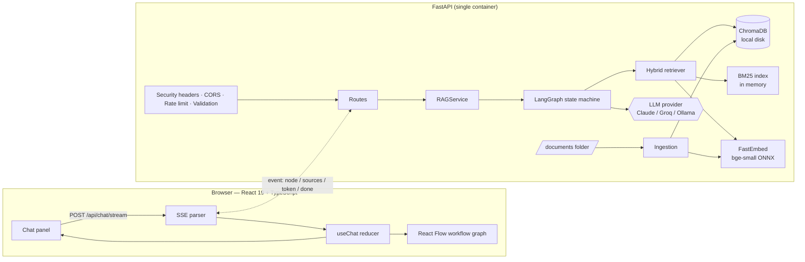
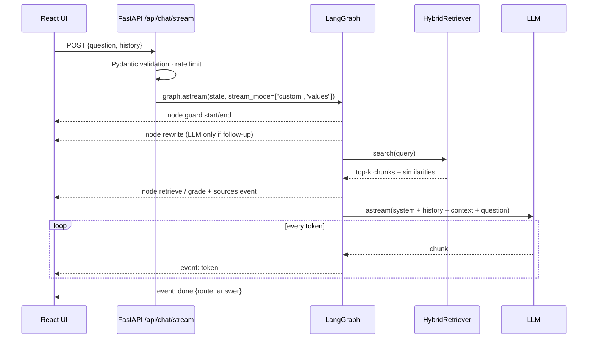

# AI Product Portfolio: seven AI products, one platform

Seven live products behind one portfolio hub, sharing one FastAPI backend, one LLM client and one local embedding model:

| Product | What it does | Route |
|---|---|---|
| **DocuMind** | Agentic RAG over your documents, with a live LangGraph workflow graph | `/documind` |
| **Keeper** | Personal assistant: where things are, who has what, what expires, what's due | `/keeper` |
| **CareerPilot** | Match score, tailored resume & cover letter, voice mock interview, application board | `/careerpilot` |
| **MeetingMind** | Recording → Whisper transcript → decisions, owners, action board, searchable archive | `/meetingmind` |
| **CodeLens** | Index a GitHub repo → cited answers (file + lines), onboarding tour, dependency graph | `/codelens` |
| **FlowForge** | Visual AI automation builder: run live, deploy as a webhook or schedule | `/flowforge` |
| **TripWeaver** | Tool-using trip agent (maps + weather), live re-planning, real-time group voting | `/tripweaver` |

DocuMind answers questions about local documents (currently a resume PDF) using **Retrieval-Augmented Generation**.
The pipeline is an explicit **LangGraph** state machine. Each step streams to a **React** UI that animates the
graph node by node while the answer is typed out with **inline citations**.

> **Stack:** Python 3.12 · FastAPI · LangGraph · ChromaDB · FastEmbed (ONNX) · BM25 · **Claude (Anthropic SDK)** ·
> Groq / Ollama ·
> React 19 · TypeScript · Vite · Tailwind CSS v4 · React Flow · Motion · Docker · GitHub Actions
>
> **Cost:** every library is free and open source, and embeddings/vector search run locally. The default LLM is
> **Claude Opus 5.5** via the Anthropic API (pay-per-use). Switch one env var to run free on Groq's free tier or
> fully offline with Ollama.

---

## Table of contents

1. [Features](#1-features)
2. [Architecture](#2-architecture)
3. [Quick start](#3-quick-start)
4. [Project structure](#4-project-structure)
5. [How it works: code walkthrough](#5-how-it-works--code-walkthrough)
6. [Security model](#6-security-model)
7. [Testing](#7-testing)
8. [Configuration](#8-configuration)
9. [Deployment (free)](#9-deployment-free)
10. [Extending the project](#10-extending-the-project)
11. [Interview prep: design decisions & trade-offs](#11-interview-prep--design-decisions--trade-offs)

---

## 1. Features

| Area | What it does |
|---|---|
| **Agentic RAG pipeline** | LangGraph workflow: guardrails → query rewrite → hybrid retrieval → relevance grading → generate, with conditional branches to *refuse* and *general knowledge* |
| **Grounded or general, never stuck** | Questions the documents cover get cited answers. Anything else is answered from general knowledge, clearly labelled, with a closing nudge back to the documents |
| **Hybrid search** | Dense vectors (semantic) + BM25 (keyword), merged with **Reciprocal Rank Fusion** |
| **Grounded answers** | The LLM answers only from retrieved context, cites sources as `[1]`, `[2]`, and says when it doesn't know |
| **Pipeline Studio** | A left-to-right React Flow canvas driven by Server-Sent Events: the active node gets a rotating gradient border, particles stream along live edges, traversed edges glow, untaken branches dim |
| **Run Inspector (explainability)** | For every answer: routing decision and confidence in plain English, KPI tiles (end-to-end, time to first token, retrieval time, evidence used), a latency waterfall, and a retrieval leaderboard showing each chunk's vector rank, BM25 rank, fused RRF score and similarity against the threshold and cutoff |
| **Run history & replay** | Every answer keeps a snapshot of its run. "Inspect run" or the run navigator replays any past answer's pipeline |
| **Workspace layouts** | Resizable split (Workspace), focused Chat, or full Pipeline view (Alt+1/2/3), all responsive down to mobile |
| **Conversational** | Follow-up questions are rewritten into standalone queries using the chat history |
| **Local storage** | ChromaDB persisted to disk; embeddings run locally on CPU (no GPU, no paid API) |
| **Incremental indexing** | SHA-256 per file: only new or changed documents are re-embedded; deleted files are purged |
| **Production hardening** | Rate limiting, strict validation, CSP and security headers, prompt-injection guard, non-root Docker, no secrets in code |
| **Library (Document Briefs)** | Every indexed document gets an AI brief (summary, highlights, topic clusters, suggested questions) generated once per file version and cached on disk |
| **Match Analyzer** | Paste a job description, RFP or checklist: a 4-stage pipeline (extract → retrieve → assess → score) streams progress and returns a weighted score with a cited verdict per requirement |
| **Conversation memory & history** | The assistant remembers the last 4 exchanges per chat (with a visible memory meter). Past chats live in an optional slide-over history drawer (search, reopen, delete), stored only in the browser |
| **Quality gates** | 88 backend tests and 19 frontend tests, Ruff, ESLint, strict TypeScript, CI on every push |

---

## 2. Architecture



**Key idea:** the backend is **stateless per request**. The client sends recent chat history with each question.
Any replica can serve any request, and no user data is stored server-side.

---

## 3. Quick start

### Prerequisites

* **Python 3.12+**
* **Node.js 22.12+** (24 LTS recommended; Vite 8 needs it). Check with `node -v`.
* An LLM, one of:
  * **Claude** (default): create an API key at <https://platform.claude.com/settings/keys>
  * **Groq** (free tier): create a key at <https://console.groq.com/keys> and set `LLM_PROVIDER=groq`
  * **Ollama** (local, offline): install from <https://ollama.com>, run `ollama pull llama3.2`, and set
    `LLM_PROVIDER=ollama`

### 1) Configure

```bash
cp .env.example .env          # then set ANTHROPIC_API_KEY (and/or GROQ_API_KEY) in .env
```

### 2) Backend (terminal 1)

```bash
cd backend
python -m venv .venv
# Windows: .venv\Scripts\activate      macOS/Linux: source .venv/bin/activate
pip install -r requirements-dev.txt
uvicorn app.main:app --reload --port 8000
```

On first start the embedding model (~130 MB) downloads into `backend/data/models` and every file in `documents/` is
indexed. API docs: <http://localhost:8000/docs>.

### 3) Frontend (terminal 2)

```bash
cd frontend
npm install
npm run dev                    # http://localhost:5173  (proxies /api → :8000)
```

### 4) Production-like single container

```bash
docker compose up --build      # http://localhost:7860
```

### Adding documents

Drop `.pdf`, `.md` or `.txt` files into [documents/](documents/) and restart the backend, or run
`python -m app.rag.ingestion` from `backend/`. Only changed files are re-embedded.

---

## 4. Project structure

```
.
├── documents/                    # Source documents (the knowledge base)
├── backend/
│   ├── app/
│   │   ├── main.py               # App factory: lifespan, middleware, SPA hosting
│   │   ├── config.py             # Typed settings (pydantic-settings, env-driven)
│   │   ├── api/
│   │   │   ├── routes.py         # HTTP endpoints incl. SSE streaming
│   │   │   └── schemas.py        # Strict request/response models
│   │   ├── core/
│   │   │   ├── security.py       # Security headers, rate limiter, admin auth
│   │   │   └── logging.py
│   │   └── rag/
│   │       ├── loaders.py        # Safe file discovery + PDF/text extraction
│   │       ├── ingestion.py      # Chunk → embed → upsert (incremental)
│   │       ├── embeddings.py     # FastEmbed wrapper
│   │       ├── vectorstore.py    # ChromaDB wrapper
│   │       ├── retriever.py      # Hybrid dense+BM25 retrieval with RRF
│   │       ├── guardrails.py     # Input normalisation + injection heuristics
│   │       ├── prompts.py        # System/rewrite prompts, context formatting
│   │       ├── llm.py            # ChatLLM interface: Claude (Anthropic SDK), Groq, Ollama
│   │       ├── graph.py          # ★ LangGraph workflow + tracing
│   │       └── service.py        # Composition root used by the API
│   ├── tests/                    # pytest: units + API (fake LLM & embedder)
│   ├── requirements.txt          # Pinned runtime deps
│   └── requirements-dev.txt
├── frontend/
│   └── src/
│       ├── App.tsx               # Layout (chat | workflow), responsive tabs
│       ├── types.ts              # Mirrors backend schemas & SSE events
│       ├── lib/
│       │   ├── api.ts            # fetch helpers + streaming client
│       │   ├── sse.ts            # Incremental SSE parser
│       │   └── layout.ts         # DAG auto-layout for the graph
│       ├── hooks/
│       │   ├── useChat.ts        # ★ Reducer: messages + workflow run state
│       │   └── useBackend.ts     # Health / graph / documents loading
│       └── components/
│           ├── chat/             # ChatPanel, MessageBubble, SourceList, Composer
│           ├── shell/            # TopBar (view switcher, KB menu), SplitPane, Backdrop
│           └── studio/           # PipelineStudio, WorkflowGraph, PipelineNode, FlowEdge, RunInspector
├── Dockerfile                    # Multi-stage: Node build → Python runtime
├── docker-compose.yml            # App (+ optional Ollama profile)
└── .github/workflows/ci.yml      # Lint, typecheck, test, build, docker
```

---

## 5. How it works: code walkthrough

### 5.1 Request lifecycle



### 5.2 Ingestion: [loaders.py](backend/app/rag/loaders.py), [ingestion.py](backend/app/rag/ingestion.py)

1. **Discovery.** `discover_files()` walks `documents/` and keeps only allow-listed extensions (`.pdf .md .txt`)
   under a size cap. Each path is `resolve()`d and must satisfy `is_relative_to(root)`, so symlinks or `..`
   can't escape the folder.
2. **Extraction.** `pypdf` extracts text **per page**, so citations can say "p.2".
3. **Chunking.** `RecursiveCharacterTextSplitter` (800 chars, 120 overlap) splits on paragraphs, then lines, then
   sentences, then words. The overlap keeps facts that straddle a boundary retrievable.
4. **Deterministic IDs.** `sha256(source|page|index|text)`. Re-ingesting identical content is an idempotent upsert.
5. **Incremental sync.** Each chunk stores its file's SHA-256. On each run:
   * same hash → skip (no embedding cost)
   * changed hash → delete the old chunks for that source, insert new ones
   * file gone → delete its chunks

   The `IngestReport` says what changed. The BM25 index is rebuilt only if something did.

### 5.3 Embeddings: [embeddings.py](backend/app/rag/embeddings.py)

* **FastEmbed** runs `BAAI/bge-small-en-v1.5` (384-dim) on **ONNX Runtime**. That means no PyTorch: a much
  smaller image, quick CPU inference, and it fits free hosting tiers.
* `query_embed` vs `passage_embed`: BGE is *asymmetric*. Queries get an instruction prefix that FastEmbed adds
  automatically, which measurably improves retrieval.
* Vectors are L2-normalised, so **dot product = cosine similarity**.

### 5.4 Vector store: [vectorstore.py](backend/app/rag/vectorstore.py)

* `chromadb.PersistentClient` stores everything on local disk (`backend/data/chroma`). There is no server process
  to run.
* The collection uses `hnsw:space = cosine`. Chroma returns *distance*, which we convert with `similarity = 1 − distance`.
* We pass `embedding_function=None` and supply vectors ourselves. The model stays explicit and identical at index
  and query time, and Chroma never silently downloads its own default model.

### 5.5 Hybrid retrieval & RRF: [retriever.py](backend/app/rag/retriever.py)

| Retriever | Strength | Weakness |
|---|---|---|
| Dense (embeddings) | Paraphrases: "work history" ≈ "experience" | Blurs exact tokens such as `C#` or `AWS` |
| Sparse (BM25) | Exact keywords, names, acronyms | No notion of synonyms |

The two rankings are fused with **Reciprocal Rank Fusion**:

$$\text{RRF}(d) = \sum_{r \in \text{rankers}} \frac{1}{k + \text{rank}_r(d)}, \quad k = 60$$

RRF uses only **ranks**, so it doesn't need BM25 scores (unbounded) and cosine scores (−1…1) to be on the same
scale, and it needs no tuning. A document ranked well by *both* retrievers rises to the top.

Implementation details worth mentioning:

* The tokenizer regex keeps tech tokens intact (`node.js`, `c++`, `c#`). A unit test catches regressions.
* For BM25-only hits we fetch their stored vectors and compute cosine similarity, so every result has a
  similarity score for grading.
* The BM25 index lives in memory behind a lock, so `refresh()` after re-indexing is safe while queries run.

### 5.6 Relevance grading: [graph.py `grade`](backend/app/rag/graph.py)

Two-step gate, tuned on this corpus (see the thresholds in [config.py](backend/app/config.py)):

1. If the **best** chunk's similarity is below `RELEVANCE_THRESHOLD` (0.50), the documents don't cover the
   question, so it routes to `general`: the LLM answers from general knowledge with a separate prompt (no
   citations, no claim that the documents say so), and the server appends a closing note that names the indexed
   documents and invites a document question. The UI badges it "General knowledge", so users can always tell
   grounded answers from general ones.
2. Otherwise keep every chunk within `RELEVANCE_MARGIN` (0.12) of the best one.

The grade step also emits a `confidence` level (`high` when the best score clears the threshold by 0.08+), the
`cutoff`, and which candidate ranks were kept. The Run Inspector uses these to explain each decision.

Why not a fixed per-chunk cutoff? When measured, relevant questions top out at 0.51–0.60 and unrelated ones at
0.39–0.49. A fixed cutoff high enough to reject noise would throw away useful supporting chunks. A relative margin
adapts to each query.

### 5.7 The LangGraph workflow: [graph.py](backend/app/rag/graph.py) ★

```
START → guard ─┬─ allowed → rewrite → retrieve → grade ─┬─ relevant → generate → END
               └─ blocked → refuse → END                └─ none     → general  → END
```

* **State** is a `TypedDict` (`RAGState`). Each node returns a *partial update* and LangGraph merges it.
* **Conditional edges** (`add_conditional_edges`) implement the branching, so control flow is data, not nested ifs.
* **Tracing without coupling.** Every node is wrapped by `traced(name, fn)`. The wrapper obtains LangGraph's
  `get_stream_writer()` and emits `node start/end/error` events with timings and a small `_detail` payload. Nodes
  stay pure business logic.
* **Token streaming.** `generate` calls `llm.astream()` and writes each token to the same custom stream.
  `service.stream()` consumes `graph.astream(stream_mode=["custom", "values"])`, yielding UI events and the final
  state.
* **Graph introspection.** `describe_graph()` reads `compiled.get_graph()` and serves nodes and edges at
  `GET /api/graph`. The frontend renders whatever the backend defines, so **adding a node in Python makes it appear
  in the UI**.
* **Non-blocking.** Retrieval is CPU-bound (embedding + BM25) and runs in `asyncio.to_thread()` so the event loop
  keeps serving other streams.
* **Lazy LLM.** The model client is created on first use. The app boots, indexes and serves retrieval even with no
  API key, and `/api/health` reports `llm_ready: false`.

### 5.8 Prompting & citations: [prompts.py](backend/app/rag/prompts.py)

* Context is wrapped as `<context><source id="1" file="…" page="…">…</source></context>`, and the system prompt
  declares it **untrusted data**. This mitigates indirect prompt injection through document content.
* The model is told to cite with `[n]`. The frontend turns `[n]` into interactive chips that highlight the matching
  source card.
* `rewrite` is skipped on the first turn, which saves an LLM call. On follow-ups it condenses history plus the
  question into a standalone search query ("And React?" becomes "What React experience does the candidate have?").

### 5.8b LLM providers: [llm.py](backend/app/rag/llm.py)

The graph depends on one small protocol, `ChatLLM`, with two methods:
`complete(system, messages, short=...)` for utility calls such as query rewriting, and `stream(system, messages)`
for the answer. `build_llm()` picks the implementation from `LLM_PROVIDER`:

| Provider | Implementation | Notes |
|---|---|---|
| `anthropic` (default) | `ClaudeLLM`, using the **official `anthropic` SDK** (`AsyncAnthropic`) | `client.beta.messages.stream(...)` → `text_stream` for tokens, then `get_final_message()` to inspect `stop_reason` |
| `groq` / `ollama` | `LangChainLLM`, wrapping `ChatGroq` / `ChatOllama` | Same interface, so the graph code is unchanged |

Claude-specific decisions:

* **Model:** `claude-opus-5-5`. Its thinking is always on (adaptive), so there's no `thinking` parameter. Depth is
  controlled with `output_config.effort`: `medium` for answers (configurable) and `low` for the cheap rewrite
  call. Sampling parameters like `temperature` aren't accepted by this model, so none are sent.
* **`max_tokens` headroom:** thinking tokens count toward `max_tokens`, so answers get 16k. A tiny cap would
  truncate mid-thought.
* **Refusals:** a safety-classifier decline is an HTTP 200 with `stop_reason == "refusal"`. The request opts into
  server-side fallback (`fallbacks: "default"`, beta `server-side-fallback-2026-07-01`), so the API retries on
  Anthropic's recommended fallback model within the same call. If the whole chain still refuses, `ClaudeLLM`
  raises `LLMRefusalError` and the UI shows a polite message.
* **Errors:** `user_facing_error()` maps SDK exceptions (`AuthenticationError`, `RateLimitError`, 5xx,
  connection errors) to safe, actionable messages. Unknown errors are logged server-side and shown generically.
  The SDK already retries 429/5xx with backoff (`max_retries=2`).
* **Graceful degradation:** if the LLM is unavailable, `rewrite` falls back to the raw question, so retrieval and
  the no-context path still work. The app boots and `/api/health` reports `llm_ready: false` when no key is set.
* **Testing:** `tests/test_claude_llm.py` swaps the SDK client for a fake and asserts the request shape (model,
  effort, fallbacks, no sampling params), streaming, refusal handling and error mapping. No network, no cost.

### 5.9 Streaming protocol (SSE)

`POST /api/chat/stream` returns `text/event-stream`:

| Event | Payload | UI effect |
|---|---|---|
| `node` | `{node, status: start\|end\|error, ms?, detail?}` | Node animates, then turns green; the Run Inspector fills in |
| `sources` | `{sources: [{id, source, page, similarity, snippet}]}` | Source cards attached to the answer |
| `token` | `{text}` | Appended to the streaming answer |
| `done` | `{route, answer, search_query}` | Run settles, untaken branches dim |
| `error` | `{message}` | Friendly error; internals never leak |

**Why SSE and not WebSockets?** Traffic is one-directional (server → client) per request. SSE is plain HTTP, so it
works through proxies and CDNs, needs no extra protocol or library, and fits FastAPI's `StreamingResponse`. We use
`fetch` + `ReadableStream` rather than `EventSource` because `EventSource` only supports GET, and we need a POST
body. `X-Accel-Buffering: no` stops reverse proxies from buffering the stream.

### 5.10 API layer: [routes.py](backend/app/api/routes.py), [schemas.py](backend/app/api/schemas.py)

| Method | Path | Purpose |
|---|---|---|
| GET | `/api/health` | Liveness + chunk count + LLM readiness |
| GET | `/api/graph` | Workflow topology for the UI |
| GET | `/api/documents` | Indexed documents with page/chunk counts |
| POST | `/api/chat` | Non-streaming answer `{answer, route, sources, trace}` |
| POST | `/api/chat/stream` | Streaming answer (SSE) |
| POST | `/api/admin/reindex` | Re-index documents. Needs `X-Admin-Key`; **404 when no key is configured** |

Routes are thin: validate, delegate to `RAGService`, shape the response. `RAGService`
([service.py](backend/app/rag/service.py)) is the **composition root**. It wires store, embedder, retriever, LLM
factory and graph, and accepts injected fakes for tests. Dependencies reach routes via FastAPI's
`Annotated[RAGService, Depends(get_rag)]`.

`main.py` uses the **app-factory pattern** (`create_app(settings, service_factory)`) plus a **lifespan** handler.
Model loading and indexing run once at startup in a worker thread.

### 5.11 Frontend architecture

| Concern | Implementation |
|---|---|
| Streaming client | [lib/api.ts](frontend/src/lib/api.ts): `fetch` → `TextDecoderStream` → [lib/sse.ts](frontend/src/lib/sse.ts) incremental parser (handles events split across network chunks and `\r\n`) |
| State | [hooks/useChat.ts](frontend/src/hooks/useChat.ts): a **pure reducer** over a discriminated union of SSE events. It manages messages (tokens, sources, errors) **and** the workflow run (`nodes[id].status`, visited `path`, client-side timings and time to first token). Timestamps arrive in the action (`now`), so the reducer stays pure and unit-testable. When a run finishes, it is **snapshotted onto its answer**, which is what makes replay possible. |
| Cancellation | `AbortController`: the Stop button aborts the fetch, and the server sees the disconnect |
| Pipeline canvas | [WorkflowGraph.tsx](frontend/src/components/studio/WorkflowGraph.tsx) uses React Flow with a custom node ([PipelineNode.tsx](frontend/src/components/studio/PipelineNode.tsx)) and a custom edge ([FlowEdge.tsx](frontend/src/components/studio/FlowEdge.tsx)). Each edge is `idle`, `live` (leads to the running node: dashed, glowing, with SVG `<animateMotion>` particles), `traversed` or `dim`. The active node's rotating border is a CSS `conic-gradient` animated through a registered `@property --angle`. A `ResizeObserver` refits the view whenever the panel resizes. |
| Layout | [lib/layout.ts](frontend/src/lib/layout.ts): a small left-to-right layered layout. Column = longest path from START, the happy path sits on the centre lane and branches alternate above and below. No layout library needed. |
| Run Inspector | [RunInspector.tsx](frontend/src/components/studio/RunInspector.tsx), with three tabs: **Overview** (decision and why, confidence meter, count-up KPI tiles, latency waterfall with a first-token marker), **Retrieval** (leaderboard: vector rank, BM25 rank, RRF, similarity bar with threshold and cutoff markers, kept/dropped, expandable preview), **Query & model** (guardrail verdict, original vs rewritten query, server TTFT, throughput, model). Uses Tailwind **container queries** (`@container`, `@3xl:`), so it lays out by its own width, not the viewport. |
| App shell | [TopBar.tsx](frontend/src/components/shell/TopBar.tsx) (segmented view switcher with a shared-layout animated pill, knowledge-base popover, live model status) and [SplitPane.tsx](frontend/src/components/shell/SplitPane.tsx) (accessible drag handle: pointer, arrow keys, double-click to reset; ratio remembered in `localStorage`). |
| Safe rendering | `react-markdown` **without** `rehype-raw`, so model output can never inject HTML or scripts. Links get `rel="noopener noreferrer nofollow"`. |
| Types | [types.ts](frontend/src/types.ts) mirrors the Pydantic schemas. `StreamEvent` is a discriminated union, so `switch (ev.event)` is exhaustively type-checked. |
| Performance | The whole Pipeline Studio (React Flow) is lazy-loaded (`React.lazy`) into its own chunk; components are `memo`ised; layout is memoised per topology |
| Motion & a11y | `motion` for entrance, stagger and shared-layout animations, wrapped in `<MotionConfig reducedMotion="user">`, plus a CSS `prefers-reduced-motion` override that disables every animation. `aria-live` chat region, labelled controls, `role="separator"` resize handle, shortcuts (`/` focuses the composer, Alt+1/2/3 switch layouts). |
| Styling | Tailwind v4 (`@theme` tokens, CSS-first config); self-hosted variable fonts via Fontsource (no third-party requests, CSP-friendly) |

---

### 5.11a Personal portfolio page

`/` is a personal portfolio: sticky scroll-spy navigation (with a mobile menu), hero with avatar and social links, three expertise cards with tech-stack chips, a vertical **career timeline** whose line draws as you scroll, the **project grid** (real screenshots in `frontend/public/projects/`, filterable into personal / work), and a **contact form**.

* **Content lives in one file:** [site/config.ts](frontend/src/site/config.ts) (`SITE`, `EXPERTISE`, `TIMELINE`), taken from the resume. Add a photo at `frontend/public/avatar.jpg` and set `avatar: '/avatar.jpg'`; set `links.github` to show the GitHub icon.
* **Contact form:** [contact.py](backend/app/products/contact.py) validates, rate-limits (3/min), drops bots via a hidden honeypot field, stores messages in `data/contact.sqlite3`, and pings Telegram if configured. Read messages with `GET /api/contact` + header `X-Admin-Key` (set `ADMIN_API_KEY`).

### 5.11b Portfolio hub & routing

The site is a **product portfolio**. `/` is a hub listing every product, and each product is its own app:

| Route | Renders |
|---|---|
| `/` | [HubPage.tsx](frontend/src/site/HubPage.tsx): intro, filterable product library, engineering highlights |
| `/documind` | The DocuMind app ([App.tsx](frontend/src/App.tsx)), lazy-loaded as its own chunk |
| `/keeper` | The Keeper app ([KeeperApp.tsx](frontend/src/products/keeper/KeeperApp.tsx)), lazy-loaded (≈15 kB gzipped) |
| `/products/<slug>` | [ProductPage.tsx](frontend/src/site/ProductPage.tsx): preview for products in development |

* **Router:** [router.tsx](frontend/src/router.tsx) is a ~40-line History-API router (`useSyncExternalStore` + `pushState`, `<Link>` that keeps native new-tab behaviour). FastAPI's SPA fallback serves `index.html` for any non-API path, so deep links and refreshes work.
* **Registry:** [site/products.ts](frontend/src/site/products.ts) is the single source of truth. Adding a product means adding one entry (and a route once it's live). Personal details live in [site/config.ts](frontend/src/site/config.ts).
* **Performance:** the hub downloads only its own bundle; product code loads when the product is opened.

### 5.11c Theming & UI polish

* **Day / night by local time.** [theme.ts](frontend/src/theme/theme.ts) has three modes: Auto (light 07:00–18:59 on the user's own clock, dark otherwise, re-checked every minute), Light and Dark, persisted per browser. [theme-init.js](frontend/public/theme-init.js) applies it **before first paint** (no flash), and it is an external file so the CSP needs no `unsafe-inline`.
* **One codebase, two themes, no `dark:` classes.** Components use semantic tokens (`ink-*` surfaces, `white` = foreground). [theme-light.css](frontend/src/styles/theme-light.css) re-maps those CSS variables: the ink scale is inverted, `white` becomes the foreground ink, and pale accent shades are swapped for deeper ones to keep contrast. This works because Tailwind v4 compiles every utility to `var(--color-…)`.
* **View Transitions API:** a circular reveal from the toggle when the theme changes, and a cross-fade between routes ([router.tsx](frontend/src/router.tsx) wraps navigation in `startViewTransition` + `flushSync`). Both respect `prefers-reduced-motion`.
* **⌘K / Ctrl+K command palette** ([CommandPalette.tsx](frontend/src/site/CommandPalette.tsx)): fuzzy-ranked jump to any product or theme, keyboard-first.
* Subtle film grain, consistent `:focus-visible` rings, spring-animated segmented controls.

### 5.12 Products beyond chat

| Product | Backend | Frontend |
|---|---|---|
| **Structured outputs** (shared) | [structured.py](backend/app/rag/structured.py): asks for JSON, extracts it robustly (code fences, surrounding prose), validates against a Pydantic schema, and retries once with the validation error fed back. Works with any provider. | — |
| **Library / Briefs** | [briefs.py](backend/app/rag/briefs.py), `GET /api/briefs?source=`. Allow-listed to indexed documents (path traversal impossible), cached at `data/briefs/<sha256>.json` keyed by file hash + prompt version, atomic writes, per-document `asyncio.Lock` so concurrent views generate once. | [LibraryView.tsx](frontend/src/components/products/LibraryView.tsx): document list, skeleton while generating, brief card, suggested questions that jump into chat |
| **Match Analyzer** | [matcher.py](backend/app/rag/matcher.py), `POST /api/match/stream` (SSE). Extracts ≤10 requirements, retrieves evidence for each **in parallel** (`asyncio.gather` + threads), one LLM-judge call where each requirement sees only its own evidence, then a weighted score (must = 2×, nice = 1×; met = 1, partial = 0.5). Out-of-range evidence ids from the model are discarded; each stage has a 90 s timeout. | [MatchView.tsx](frontend/src/components/products/MatchView.tsx): stage stepper, animated score ring, composition bar, status filters, expandable evidence quotes, cancel, copy-as-Markdown |
| **Memory** | `MAX_HISTORY_MESSAGES = 8` (4 exchanges) caps what the rewrite and answer steps see | `MEMORY_TURNS = 4` in [useChat.ts](frontend/src/hooks/useChat.ts); only *completed* Q/A pairs are sent; memory meter in the composer |
| **History** | Stateless by design: nothing stored server-side | [sessions.ts](frontend/src/lib/sessions.ts) (pure, unit-tested) + [HistoryDrawer.tsx](frontend/src/components/shell/HistoryDrawer.tsx): auto-save after each turn, grouped by day, search, two-step delete, Alt+H |

**Citations.** [citations.ts](frontend/src/lib/citations.ts) normalises whatever the model emits (`【2†L4-L7】`, `[1, 3]`, `[2–5]`), collapses repeats and strips trailing "Sources:" sections, since the UI already shows source cards. The system prompt also forbids those formats.

**TLS behind HTTPS inspection.** [core/tls.py](backend/app/core/tls.py) uses `truststore` so Python verifies certificates against the **OS trust store**. Verification stays on, and it works on machines whose antivirus or corporate proxy re-signs HTTPS traffic.

### 5.13 Keeper: personal assistant

**What it does.** One input (type, dictate or snap a photo) covers 10 chores: **Stash** (where things are), **Parking** (GPS pin), **Lend & borrow**, **Expiry radar** (IDs, policies, warranties; reminders 30 and 7 days before), **Bills & subscriptions** (paste a bank SMS; flags subscriptions unused for 30 days), **Occasions & gift ideas**, **Appliance service**, **Pantry & shopping list**, **Care** (medicines, plants, pets, one-off reminders) and a **Daily brief**.

```
message ─▶ understand ──▶ act ──▶ respond          (LangGraph, backend/app/keeper/agent.py)
            │ LLM → JSON → Pydantic `Command`        │ per-chore rules: upsert "moved" items, one
            │ (falls back to offline regex rules)     │ parking spot, roll recurring dates, pantry need/have
```

| Layer | Files | Notes |
|---|---|---|
| Router agent | [agent.py](backend/app/keeper/agent.py) | LLM output is validated (`complete_json` + `_plausible`); on any failure or timeout the **rule parser** takes over, so Keeper works with no LLM at all. Each node is timed and returned as a trace (shown under every reply). |
| Offline understanding | [parser.py](backend/app/keeper/parser.py) | Regex rules + a date parser (`15th`, `in 2 weeks`, `12/03/2027` day-first, `March 2031` → end of month, weekdays), times, money (₹/Rs/INR/$/€/£), frequencies. Covered by 25 parametrised tests. |
| Scheduling | [schedule.py](backend/app/keeper/schedule.py) | Pure functions: next due dates, "done" transitions (bills roll forward and catch up missed periods; birthdays move to next year; doses go to the next time slot), agenda buckets, template brief. |
| Storage | [store.py](backend/app/keeper/store.py) | SQLite (WAL, one file), column whitelist + bound parameters, typo-tolerant search over title/place/person/note/**photo caption**. Photos are checked by **magic bytes** (JPEG/PNG/WebP), saved under random ids (no path traversal), orphan photos pruned after a day. |
| Vision | [vision.py](backend/app/keeper/vision.py) | Groq `qwen/qwen3.8-27b` (free tier) or Claude reads labels, warranty cards and receipts into an editable draft. **Human in the loop:** nothing from a photo is saved until you confirm. |
| API | [api/keeper.py](backend/app/api/keeper.py) | `POST /command`, CRUD on `/entries`, `/agenda`, `/brief`, `/photos`, `/scan`, optional `/brief/telegram`. The browser sends `X-TZ-Offset` so "today" is the user's day. Optional `KEEPER_ACCESS_KEY` (constant-time compare). |
| Frontend | [products/keeper/](frontend/src/products/keeper/) | Native device APIs only: camera (downscaled on-device to ≤1600 px before upload), Web Speech dictation, Geolocation for parking, `speechSynthesis` to read the brief aloud, Notification API reminders, installable PWA ([sw.js](frontend/public/sw.js), [keeper.webmanifest](frontend/public/keeper.webmanifest)) with offline shell. |

**Beyond the browser.** Set `TELEGRAM_BOT_TOKEN` + `TELEGRAM_CHAT_ID` and a background task sends the daily brief at `KEEPER_BRIEF_HOUR` (user's local time); the UI also gets a "Send to Telegram" button.

### 5.14 The product suite (CareerPilot, MeetingMind, CodeLens, FlowForge, TripWeaver)

**Shared platform.** [suite.py](backend/app/products/suite.py) wires every product to the same lazily-created LLM client and local FastEmbed model. [docstore.py](backend/app/core/docstore.py) is a small JSON document store on SQLite (one file per product, WAL, parameterised SQL). [ai.py](backend/app/core/ai.py) provides structured calls with timeouts, safe error text, SSE framing and `Lenient`: LLM output schemas trim over-long lists/strings instead of failing (models often return 12 items when asked for 8). The frontend shares [products/shared/](frontend/src/products/shared/): `ProductShell`, tabs, SSE-over-POST client, citation-aware Markdown.

| Product | Backend | Frontend | Notable engineering |
|---|---|---|---|
| **CareerPilot** | [careerpilot.py](backend/app/products/careerpilot.py) | [CareerPilotApp.tsx](frontend/src/products/careerpilot/CareerPilotApp.tsx) | **Reuses DocuMind's Match engine** (same SSE endpoint). Tailoring forbids invented facts. Adaptive interview: answers ≤ 3/5 get exactly one follow-up inserted after them. Questions read aloud (`speechSynthesis`), answers by voice (Web Speech). Drag-and-drop application board. |
| **MeetingMind** | [meetingmind.py](backend/app/products/meetingmind.py) | [MeetingMindApp.tsx](frontend/src/products/meetingmind/MeetingMindApp.tsx) | In-browser recording (`MediaRecorder` + live level meter) sent as raw audio (size-capped) to Groq Whisper with segment timestamps; or paste a transcript. One validated extraction call. Transcript windows embedded locally; archive answers cite meeting + timestamp and jump to that moment. |
| **CodeLens** | [codelens.py](backend/app/products/codelens.py) | [CodeLensApp.tsx](frontend/src/products/codelens/CodeLensApp.tsx) | Zip downloaded from a **fixed host** (no SSRF), size-capped, read **in memory** (no extraction → no zip-slip). Python chunked by `ast` with exact line ranges (decorators included), other languages by symbol regex. Hybrid dense + BM25 with RRF. Import graph rendered in React Flow (grouped by directory for big repos). Tour steps referencing non-existent paths are dropped. |
| **FlowForge** | [flowforge.py](backend/app/products/flowforge.py) | [FlowForgeApp.tsx](frontend/src/products/flowforge/FlowForgeApp.tsx) | Flow **validation** before save (one trigger, Kahn cycle check, reachability, required fields, `{{ref}}` resolution). DAG runtime streams `node_start/end/skip/error`; condition branches skip the untaken side. HTTP node is SSRF-safe (https only, DNS → public IPs only, no redirects, 200 KB cap). Deploy as webhook (random token, constant-time compare) or schedule. Keeper node = cross-product integration. |
| **TripWeaver** | [tripweaver.py](backend/app/products/tripweaver.py) | [TripWeaverApp.tsx](frontend/src/products/tripweaver/TripWeaverApp.tsx) | Agent with real tools: Open-Meteo geocoding + 16-day forecast, place lookup via Photon with automatic fallback to OSM Nominatim (1 req/s policy, bounded viewbox, cached). Plans respect rain probability; re-planning rewrites only affected days and keeps votes. **Group mode:** votes broadcast over SSE to every open browser; clients resync on every reconnect so no update is lost. Leaflet map on OpenStreetMap tiles (re-tinted for dark mode); offline copy of the last-viewed trip. |

## 6. Security model

Defence in depth: each layer assumes the one before it can fail.

| Threat | Mitigation | Where |
|---|---|---|
| Secret leakage | All secrets come from env vars / `.env` (git-ignored) as `SecretStr` (masked in logs and reprs) | `config.py`, `.gitignore` |
| Abuse / LLM quota drain | Per-IP rate limit (`20/minute` by default); Uvicorn `--proxy-headers` so the real client IP is used behind a load balancer | `core/security.py`, `Dockerfile` |
| Oversized / malformed input | Pydantic `extra="forbid"`, length caps (question ≤ 1000 chars, ≤ 20 history items), roles restricted to `user`/`assistant`, so a client can't inject a `system` message | `api/schemas.py` |
| Unicode and control-char tricks | NFKC normalisation + control-character stripping before any processing | `guardrails.py` |
| Direct prompt injection | Heuristic guard node blocks common jailbreak phrasings *before* any LLM call | `guardrails.py`, `graph.py` |
| Indirect injection (via documents) | Context wrapped in tags and declared untrusted; system prompt is server-side only | `prompts.py` |
| Hallucination | Relevance gate + "answer only from context" + mandatory citations | `graph.py`, `prompts.py` |
| XSS | No raw HTML rendering of model output; strict CSP (`script-src 'self'`, `object-src 'none'`) | `MessageBubble.tsx`, `security.py` |
| Clickjacking | `frame-ancestors 'none'` + `X-Frame-Options: DENY` (configurable) | `security.py` |
| MIME sniffing, referrer leaks | `nosniff`, `strict-origin-when-cross-origin`, `Permissions-Policy`, COOP | `security.py` |
| Transport | HSTS in production (TLS terminates at the platform edge) | `security.py` |
| Path traversal | Resolved-path containment checks for documents and static files (tested) | `loaders.py`, `main.py` |
| Information disclosure | Generic 500 handler; stream errors return friendly messages; `/docs` and OpenAPI disabled in production; no source maps shipped | `main.py`, `routes.py`, `vite.config.ts` |
| Over-permissive CORS | Explicit origin allow-list, only `GET`/`POST`, no credentials | `main.py` |
| Admin endpoint | Doesn't exist (404) unless `ADMIN_API_KEY` is set; constant-time comparison (`secrets.compare_digest`) | `security.py` |
| Upload attack surface | **No public upload endpoint.** Documents are deployed with the app. | design decision |
| Container escape / privilege | Non-root user (uid 1000), slim base image, `no-new-privileges`, `cap_drop: ALL` | `Dockerfile`, `docker-compose.yml` |
| Supply chain | Pinned dependencies, lockfile + `npm ci`, CI with least-privilege `permissions: contents: read` | `requirements.txt`, `ci.yml` |

**Pure-ASGI middleware:** `SecurityHeadersMiddleware` is written as raw ASGI instead of Starlette's
`BaseHTTPMiddleware`, which historically buffered or broke streaming responses. Headers are injected on
`http.response.start`, so SSE stays streaming.

---

## 7. Testing

```bash
cd backend && pytest                 # 88 tests, fully offline
cd frontend && npm test              # 19 tests (vitest)
```

* **Fakes, not mocks.** `FakeEmbedder` (hashed bag-of-words vectors) and LangChain's `GenericFakeChatModel` are
  injected through `RAGService(..., llm_factory=..., embedder=...)`. Tests exercise the *real* graph, Chroma and
  BM25 with no network access and no model downloads.
* **Backend coverage:** guardrail patterns, RRF maths, tokenizer edge cases, incremental ingestion
  (add/unchanged/update/remove), file filtering, SSE event order, each graph route (answered / general /
  blocked), follow-up rewrite, validation (422s), security headers, admin auth (404/401/200), graceful degradation when the LLM is down, SPA fallback and path
  traversal.
* **Keeper coverage:** 25 phrasing cases for the offline parser, date maths (month ends, leap days, catch-up of missed bills), agenda buckets and nudges, store search via photo captions, photo validation and pruning, the full API flow, vision scan with a fake model, access-key enforcement, and the LLM-router path.
* **Suite coverage:** a scripted fake LLM (answers by prompt type) + fake map/weather tools + an in-memory zip repo exercise every product end to end: tailoring and adaptive follow-ups, meeting extraction/board/archive and the audio path, chunking/import edges/cited answers/tour path filtering, flow validation (cycles, refs, triggers), branch skipping, webhook → Keeper, SSRF rejections, trip plan → weather alert → re-plan → votes.
* **Frontend coverage:** theme-by-time rule, palette ranking, Keeper urgency and labels, SSE parser chunk reassembly, graph layout invariants, and reducer transitions (tokens,
  skipped branches, errors), and history filtering.
* **Static checks:** Ruff (incl. `flake8-bandit` security rules and async rules), ESLint with React Hooks rules,
  strict TypeScript (`noUncheckedIndexedAccess`).

---

## 8. Configuration

All settings live in [config.py](backend/app/config.py) and can be overridden by environment variables (the
uppercase field name).

| Variable | Default | Notes |
|---|---|---|
| `LLM_PROVIDER` | `anthropic` | `anthropic`, `groq` or `ollama` |
| `ANTHROPIC_API_KEY` | — | From platform.claude.com |
| `CLAUDE_MODEL` | `claude-opus-5-5` | Any Claude model ID |
| `CLAUDE_EFFORT` | `medium` | `low` … `max`: reasoning depth vs. latency and cost |
| `CLAUDE_MAX_TOKENS` | `16000` | Includes thinking tokens |
| `GROQ_API_KEY` | — | Free at console.groq.com |
| `GROQ_MODEL` | `openai/gpt-oss-120b` | Any Groq chat model |
| `OLLAMA_BASE_URL` / `OLLAMA_MODEL` | `http://localhost:11434` / `llama3.2` | |
| `ENVIRONMENT` | `development` | `production` disables docs and enables HSTS |
| `CORS_ORIGINS` | `http://localhost:5173` | Comma-separated |
| `RATE_LIMIT` | `20/minute` | slowapi / limits syntax |
| `ADMIN_API_KEY` | — | Enables `/api/admin/reindex` |
| `FRAME_ANCESTORS` | `'none'` | Set to `https://huggingface.co` on HF Spaces |
| `EMBEDDING_MODEL` | `BAAI/bge-small-en-v1.5` | Any FastEmbed model (re-index after changing) |
| `CHUNK_SIZE` / `CHUNK_OVERLAP` | `800` / `120` | Characters |
| `TOP_K` / `CANDIDATE_K` | `5` / `12` | Final results / per-retriever candidates |
| `RELEVANCE_THRESHOLD` / `RELEVANCE_MARGIN` | `0.50` / `0.12` | Re-tune per corpus |

---

## 9. Deployment (free)

### Option A: Hugging Face Spaces (recommended, one URL)

The free CPU tier has plenty of RAM for this app. It may sleep when idle and wake on the next visit.

1. Create a new Space → **SDK: Docker** → blank template.
2. Push this repo to the Space. Put this front-matter at the **top of the Space's README.md**:
   ```yaml
   ---
   title: DocuMind
   emoji: 🧠
   sdk: docker
   app_port: 7860
   ---
   ```
3. In **Settings → Variables and secrets** add:
   * Secret `ANTHROPIC_API_KEY` (or `GROQ_API_KEY` + variable `LLM_PROVIDER=groq`)
   * Variable `FRAME_ANCESTORS` = `https://huggingface.co` (the Space page embeds the app in an iframe)
   * Optional secret `ADMIN_API_KEY`
4. The Dockerfile builds the frontend, installs the backend, and **bakes the embedding model and index into the
   image**, so cold starts don't download anything.

### Option B: Any Docker host (Render, Railway, Fly.io, a VM)

```bash
docker build -t documind .
docker run -p 7860:7860 -e ANTHROPIC_API_KEY=... documind
```

The platform's `PORT` variable is respected. TLS is terminated by the platform.

### Option C: Split hosting

Host `frontend/` on **Vercel / Netlify / Cloudflare Pages** with `VITE_API_BASE_URL=https://your-api.example.com`.
Deploy the backend with `SERVE_FRONTEND=false` and `CORS_ORIGINS=https://your-frontend.example.com`.

### Going-live checklist

- [ ] `ENVIRONMENT=production`
- [ ] `ANTHROPIC_API_KEY` (or `GROQ_API_KEY`) set as a platform **secret**, never committed
- [ ] `RATE_LIMIT` suited to your budget or quota. Every chat request is a paid Claude call; consider a spend limit
      in the Claude Console.
- [ ] Only documents you're happy to make public are in `documents/`, since anyone can ask about them
- [ ] CI green

---

## 10. Extending the project

The full, phased product plan lives in **[ROADMAP.md](ROADMAP.md)**. Highlights:

Natural next steps, roughly in order of interview value:

1. **Evaluation harness.** A golden Q&A set plus RAGAS-style metrics (faithfulness, answer relevance, context
   precision) in CI to catch regressions when tuning chunking or thresholds.
2. **Cross-encoder re-ranking.** Add a `rerank` node between `retrieve` and `grade` (FastEmbed ships ONNX
   rerankers). The UI picks it up automatically from `/api/graph`.
3. **LLM-based grading or self-reflection.** A node that checks the answer is supported by the context and loops
   back to `rewrite` if not (corrective / self-RAG).
4. **Authenticated uploads.** `POST /api/admin/documents` with MIME sniffing, size limits and background ingestion.
5. **Observability.** OpenTelemetry spans per node (the `traced` wrapper is the hook point), LangSmith, and
   structured JSON logs.
6. **Horizontal scale.** A Redis-backed rate limiter, a shared vector DB (Qdrant / pgvector), and a background
   worker for ingestion.
7. **Persistent conversations** with user auth (OAuth) using LangGraph checkpointers.

---

## 11. Interview prep: design decisions & trade-offs

**Q: Walk me through what happens when a user asks a question.**
The React composer calls `useChat.send()`. It POSTs the question and recent history to `/api/chat/stream`.
FastAPI validates and rate-limits the request, then `RAGService.stream()` runs the LangGraph. `guard` blocks
injections. `rewrite` makes follow-ups standalone. `retrieve` runs dense + BM25 search fused with RRF. `grade`
gates on similarity: off-topic questions go to `general` (general-knowledge answer + nudge), otherwise the sources are emitted. `generate` streams
tokens with citations. Every node emits start/end events through LangGraph's custom stream. These go out as SSE,
the frontend reducer folds them into message and workflow state, and React Flow re-renders node statuses live.

**Q: Why answer off-topic questions at all instead of refusing?**
A hard "I don't know" feels broken to users. The `general` branch keeps the conversation useful while staying
honest: a separate prompt forbids citations or claiming document support, the UI labels the answer "General
knowledge", and a server-appended nudge steers the user back to what the system is uniquely good at. Hallucination
risk stays contained because grounded and general answers can never be confused.

**Q: How do you make a RAG system explainable?**
Every node emits structured telemetry, not just logs: per-chunk dense and BM25 ranks, fused RRF score and
similarity; the grading threshold, cutoff and confidence; time to first token. The Run Inspector turns that into
"why this answer": which passages won and by how much, why a question was routed to general knowledge, and where
the latency went. The same data would feed offline evals and production monitoring.

**Q: How do you get reliable structured output from an open-weight model?**
Ask for a JSON schema in the prompt, parse defensively (strip code fences and prose), validate with Pydantic, and
on failure retry once with the validation error in the conversation. Downstream code only sees validated
objects, model-supplied ids are bounds-checked, and missing items get safe defaults instead of crashing the report.

**Q: Why keep chat history in the browser instead of a database?**
It keeps the API stateless (any replica serves any request), stores no PII server-side, and needs no auth to be
safe. The trade-off is no cross-device sync; persistent server-side conversations are a roadmap item behind auth.

**Q: Why LangGraph rather than a simple LangChain chain?**
RAG in production isn't linear. It needs branches (refuse, general knowledge), possibly loops (self-correction), and
observable steps. LangGraph makes control flow explicit and inspectable: we derive the UI graph from
`compiled.get_graph()`. Each node is independently testable, and adding a step is one `add_node` plus edges.

**Q: Why hybrid search?**
Dense embeddings miss exact identifiers (framework names, acronyms, versions), and BM25 misses paraphrases.
Resumes are full of both. RRF fuses ranks without score calibration and is robust with no tuning.

**Q: How do you prevent hallucinations?**
In four layers. (1) A relevance gate: if nothing is similar enough, the LLM isn't called at all. (2) A system
prompt that restricts answers to the context and requires "I couldn't find it" otherwise. (3) Mandatory citations
the user can verify against source snippets. (4) Context-only prompting with refusal handling. The next step would be an automated
faithfulness check (see §10).

**Q: How were the thresholds chosen?**
Empirically. I logged similarity scores for on-topic and off-topic questions on this corpus (bge-small scores sit
in a narrow 0.3–0.6 band) and picked a gate that separates them. A relative margin then keeps supporting chunks.
They're config values because they're corpus- and model-specific. An eval set would make tuning systematic.

**Q: Why use the Anthropic SDK directly for Claude instead of a LangChain wrapper?**
Direct access to Claude-specific features (effort control, server-side refusal fallbacks, typed `stop_reason`
and error classes) without waiting for a wrapper to expose them, and one less abstraction to debug. A thin
`ChatLLM` protocol keeps the graph provider-agnostic, so Groq and Ollama still plug in for free or offline runs.

**Q: Why FastEmbed and not sentence-transformers?**
sentence-transformers pulls in PyTorch (hundreds of MB to GB), which bloats images and is slow on free CPU tiers.
FastEmbed runs the same class of models on ONNX Runtime: smaller and faster, and quality is identical for
inference.

**Q: Why is the backend stateless?**
History travels with each request (capped and validated). That means no session store, no PII at rest, trivial
horizontal scaling, and no cross-user leakage. The trade-off is slightly larger requests and trusting
client-supplied history. That's acceptable because it only affects that user's own session, and roles are
restricted so a client can't inject `system` messages.

**Q: How does streaming work end to end, and what about back-pressure or cancellation?**
`StreamingResponse` wraps an async generator. Starlette stops iterating when the client disconnects, which
cancels the graph run and the upstream LLM stream. The browser side uses `AbortController`. Proxies are told not
to buffer (`X-Accel-Buffering: no`).

**Q: What would you change to support 10,000 users?**
Run multiple replicas behind a load balancer (already possible, since the backend is stateless). Move rate limits
to Redis. Replace embedded Chroma with a managed or shared vector DB. Ingest in a worker queue. Add response
caching for frequent questions (semantic cache). Move to a paid or self-hosted LLM with concurrency limits and a
circuit breaker. Add OpenTelemetry tracing and SLO dashboards (p95 time-to-first-token, error rate).

**Q: What are the security risks specific to LLM apps, and how did you handle them?**
Direct and indirect prompt injection, data exfiltration through the model, cost-based denial of service, and XSS
through model output. Mitigations: input guard + normalisation, context tagged as untrusted, server-only system
prompt, rate limiting + input caps, markdown rendering without raw HTML + strict CSP, and no tool or function
calling, so there's no "excessive agency" (OWASP LLM Top 10).

**Q: Why serve the React build from FastAPI?**
One container, one origin. No CORS in production, a simpler CSP (`connect-src 'self'`), and one free deployment.
Split hosting is still supported through `VITE_API_BASE_URL` and `CORS_ORIGINS`.

**Q: How is the code testable?**
Dependency injection at the composition root: `create_app(settings, service_factory)` and
`RAGService(llm_factory, embedder)`. Tests inject deterministic fakes and run the real graph, vector store and
HTTP layer offline in about 2 seconds. The frontend reducer is a pure function tested without rendering.

**Q: What would you improve with more time?**
An eval harness in CI, a cross-encoder reranker, self-corrective RAG, OpenTelemetry, and authenticated uploads
(see §10).
