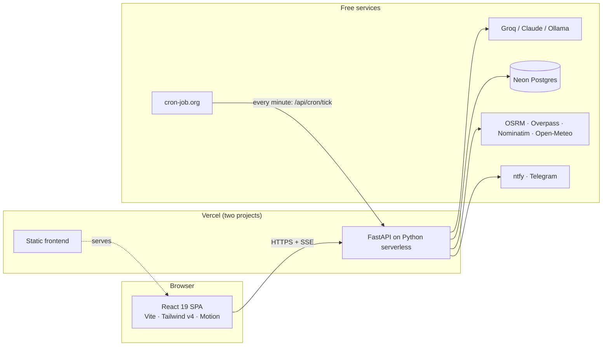
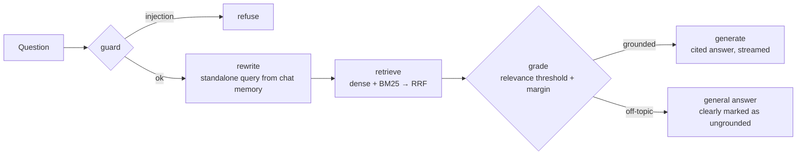

# AI Full-Stack Developer Portfolio

**Four AI products in one React + FastAPI monorepo, each solving one everyday problem, built on free-tier
infrastructure by Sidharth Rout (6 years in software; Senior Consultant at Deloitte, AI & Data, delivering Generative-AI
proofs of concept as an LLM Engineer).**

[Live site](https://ai-full-stack-developer-portfolio-p-ruby.vercel.app) ·
[Quality (evals)](https://ai-full-stack-developer-portfolio-p-ruby.vercel.app/quality) ·
[API health](https://ai-full-stack-developer-portfolio-b.vercel.app/api/health) ·
[How it works](docs/HOW_IT_WORKS.md) ·
[Roadmap](ROADMAP.md)


The site is problem-first: each product starts from a problem people recognise and the outcome it gives them. Four are
featured; earlier apps are kept as frozen "in development" tiles and their code is reused as shared capabilities.
Everything shares one backend: a free-tier LLM router (Groq) with offline fallbacks, hybrid retrieval, LangGraph agents,
evaluation suites, and a storage layer that runs on SQLite locally and on Postgres (Neon) in production.

The single source of truth for product identity, status and visibility is
[frontend/src/site/products.js](frontend/src/site/products.js); every count on the site is derived from it.

---

## Portfolio (featured products)

| # | Product | Problem it solves | What exists today |
| --- | --- | --- | --- |
| 1 | **Safarnaama** (`/safarnaama`) | Planning a trip means juggling a dozen tabs and apps | Plans, places and moments in one story-like flow; Google sign-in (Neon Auth) to keep trips across devices; a "did you book it?" return prompt after provider hand-offs. Live prices and in-app booking need provider partnerships |
| 2 | **CodeLens** (`/codelens`) | Joining a new codebase and waiting days for KT sessions | Paste a public GitHub repo: symbol-aware chunking, hybrid search (BM25 + embeddings, fused with RRF), an import graph and a guided onboarding pack, with live progress while it indexes |
| 3 | **Tara** (`/tara`) | An assistant that actually gets things done, by voice or text | Voice-first assistant: "Hey Tara" and pause-aware listening, weather/news/facts/rates, device actions, memory and phone reminders, 20 expert personas picked per question. **Products first**: trips go to Safarnaama (with the place filled in), repos to CodeLens, failing builds to Jasoos. Answers about this site's own code and documents, and owner-only code changes proposed as reviewed pull requests |
| 4 | **Jasoos** (`/jasoos`) | A build, test or deploy failed and the log is thousands of lines long | Parses CI logs and stack traces into evidence, then reasons to a likely cause and fix |

Frozen (shown as "in development"): Pramaan, Vaada, CareerPilot, FlowForge, Evolve. Their working code stays in the
repository (DocuMind RAG Studio at `/documind`, MeetingMind at `/meetingmind`) and feeds the featured products.

Statuses follow one rule: **Live** only when the principal workflow works end to end, persists, is access-controlled
where needed and is tested. The featured products are in **beta**.

**Quality.** `/quality` runs evaluation suites per product or for the whole app:
- **App checks:** deterministic suites covering retrieval, parsers, rules, device actions and **13 security controls**.
- **Live-model evals:** routing, emotion and expert choice.
- **Metrics:** each score comes with a 95% interval, macro-F1, MRR/nDCG for retrieval, p50/p95 latency and coverage.
- **History:** every run is kept, with trend lines, the change since the last run and regression flags.
- **Standards:** each metric names the standard it follows (ISO/IEC 25010, NIST AI RMF, OWASP Top 10 for LLM apps and
  OWASP API Top 10; aligned with, not certified).

**Two faces of the home page.** The **Studio** (default) is calm and recruiter-first. **Off the clock**, the personal
space, is bright and playful: a self-shuffling deck of product cards, a swipeable product strip, and scroll-driven
type. The skin switch moves between them, and both follow light/dark mode.

**Owner pages** (owner key, not linked or indexed):
- `/control`, the control room: the AI provider (Groq free tier or Claude within a monthly budget), pausing products,
  Tara's switches, and an audited change history.
- `/insights`: cookie-free visit analytics with advice.

**One sign-in, private data.** A **Sign in** button (Google, or an emailed link, through Neon Auth) sits in every
product. It's optional, because each product already keeps every visitor's data private to their browser. Signed in,
your Tara items, CodeLens repos, Jasoos investigations and Safarnaama trips follow you to every device.

How all of this works, including the logic behind the animations, is in **[docs/HOW_IT_WORKS.md](docs/HOW_IT_WORKS.md)**.

---

## Architecture



### The RAG pipeline (DocuMind)



Each node is wrapped in a tracer, so the frontend's Pipeline Studio replays exactly what happened: timings, retrieved
chunks with their fused scores, and the route taken.

---

## Engineering decisions

**One storage abstraction, two engines.** `appcore/db.py` ([packages/py-core](packages/py-core)) writes portable SQL once. Locally each product gets its own
SQLite file. When a `DATABASE_URL` is present (Neon on Vercel), the same code runs on Postgres with an identical layout
(each SQLite file is a Postgres schema with the same tables, columns and indexes: `keeper.entries`, `evolve.docs`) and
a PgBouncer-safe psycopg 3 connection (no server-side prepared statements). Serverless instances share no disk, so this
is what makes data survive across requests. `GET /api/health` reports which engine is live and, if it fell back, which
variable names it saw (never their values).

**Serverless-aware runtime.** The bundle is read-only and only `/tmp` is writable. Model caches and data directories are
redirected there when `VERCEL` is set. Background schedulers are switched off on serverless hosts and replaced by an
authenticated `/api/cron/tick` endpoint, which an external free cron calls every minute. Docker and local runs keep
in-process schedulers. Startup failures return a 503 with a sanitised cause instead of an opaque 500.

**Provider-agnostic LLM layer with a Groq router.** Groq (free tier, default), Anthropic Claude and local Ollama sit
behind one interface, selected by `LLM_PROVIDER`. With Groq, every call goes through the
[central router](#central-groq-llm-router), which picks a free-tier model per task. Structured outputs are validated with
Pydantic. Every agent has a deterministic fallback, so a quota error degrades the feature instead of breaking it.

**Hybrid retrieval without a vector database.** FastEmbed (`bge-small-en-v1.5`, ONNX, CPU-only) produces the embeddings.
Vectors live in SQLite or Postgres and are searched with NumPy, then fused with BM25 using Reciprocal Rank Fusion
(k = 60). Removing ChromaDB kept the deployed function under Vercel's 500 MB limit with no loss of quality at this scale.

**Free-tier first.** Everything runs without a credit card: Groq, Neon, Vercel Hobby, OpenStreetMap services, ntfy
push and cron-job.org. Moving to a paid model (Claude) is a one-variable switch, and phone delivery sits behind a
small channel interface, so SMS can be added without touching the reminder logic.

**Defence in depth.** The defences are layered:
- Inputs: guardrail heuristics catch prompt injection before any tokens are spent, and retrieved context is
  delimiter-tagged in the prompt.
- Rendering: Markdown is rendered without raw HTML.
- Requests: per-IP rate limits (slowapi), a strict CORS allow-list with credentials disabled, security headers (CSP,
  nosniff, framing, HSTS in production), and an optional access key for personal data (Tara; its API is still `/api/keeper`).
- Links: one-tap reminder actions use HMAC-signed, expiring tokens.

---

## Jasoos (internally EFI): Engineering Failure Investigator

CodeLens explains how code works; EFI explains why a specific run failed, which evidence supports that, and how to
check a fix. It lives in [backend/app/efi/](backend/app/efi/), [backend/app/api/efi.py](backend/app/api/efi.py) and
[frontend/src/products/efi/](frontend/src/products/efi/).

**Supported artifacts** (text only, sent as JSON; no archives, nothing is executed or extracted to disk):
build / CI / deploy logs (GitHub Actions, GitLab, Jenkins, npm, pytest, Maven, Gradle, Docker), stack traces
(Python, JS/TS, Java/Kotlin, Go) and compiler `file:line` errors, unified git diffs (`.diff`, `.patch`, pasted
`git diff` output), JUnit XML, dependency manifests and lockfiles, config files, and free-text notes.

**Pipeline**
1. *Intake:* extension allow-list, size caps, binary and control-character checks, JUnit XML with DOCTYPE/ENTITY rejected.
2. *Redaction* ([redact.py](backend/app/efi/redact.py)): API keys and tokens (AWS, GitHub, GitLab, Slack, Google,
   Stripe, Groq, OpenAI, Anthropic, npm), JWTs, PEM private keys, URL passwords, `Authorization` headers and
   `password=` / `API_KEY:` style values are replaced **before anything is stored or sent to the model**. If a
   credential still matches after redaction, the artifact is rejected.
3. *Deterministic parsing* ([parsers.py](backend/app/efi/parsers.py)) into evidence items `EV-001…` with artifact,
   line, kind and status. The same input always produces the same IDs.
4. *Correlation* ([evidence.py](backend/app/efi/evidence.py)): only from facts in the artifacts (frame inside a
   changed hunk, frame in a changed file, failing test defined in a changed file, changed dependency or config file
   named in a failure). Plus a timeline (timestamps or log order) and the first failure.
5. *Context selection:* failures first, then correlated items, then BM25 relevance (reusing the DocuMind/CodeLens
   retrieval code), within `EFI_MAX_CONTEXT_CHARS`.
6. *Groq reasoning* ([reasoning.py](backend/app/efi/reasoning.py)): **only when the user clicks Analyse**. One call to
   `openai/gpt-oss-120b` through the central Groq router (task `efi.investigate`: only models meeting the advanced
   reasoning floor are eligible; one extra call only to repair invalid JSON), calls serialised per process, bounded
   router retries on 429/5xx, and an overall timeout. Artifact
   text is declared untrusted in the prompt. There is **no fallback to another provider**: if Groq's free-tier limit
   is hit, the API returns 429 with a "retry after the quota resets" message.
7. *Verification:* unknown evidence IDs removed; hypotheses without valid supporting evidence rejected; file paths not
   present in the artifacts removed or flagged; reproduction commands marked "seen in artifacts" only if they appear
   verbatim; confidence capped (notes only → low; "high" needs a correlation or two observed items).
8. *Report:* summary (labelled model-generated), symptoms, timeline, up to 5 ranked hypotheses with supporting and
   contradicting evidence, affected files, reproduction, suggested remediation, a validation checklist built from the
   artifacts (re-run the failing tests and commands), limitations, and "mark the actual root cause" feedback. With no
   failure signal at all, the report says "insufficient evidence" and no model call is made.

**Identity and isolation.** The portfolio has no user accounts. EFI follows the existing header-key convention: the
browser gets an unguessable token from `POST /api/efi/owner` and sends it as `X-EFI-Owner`. The server stores only
`sha256(token)` and every query filters on it (`WHERE owner = ? AND id = ?`), so another browser gets a 404. History
is tied to that browser; clearing site data loses access to it.

**Retention.** Raw (redacted) artifacts expire after `EFI_RETENTION_DAYS` (14). They are deleted by the existing
`/api/cron/tick` and on access (at most every 10 minutes per instance). On Vercel, deletion therefore happens when the
cron runs or the API is used; it is not a guaranteed background job. Reports (with short evidence snippets) stay until
the user deletes the investigation. Investigation content is never used for training.

**API** (all except `/owner` and `/limits` need `X-EFI-Owner`)

| Method | Path | Purpose |
| --- | --- | --- |
| POST | `/api/efi/owner` | New owner token for this browser |
| GET | `/api/efi/limits` | Size limits, retention, model |
| POST | `/api/efi/investigations` | Create: validate, redact, parse, correlate (no model call) |
| GET | `/api/efi/investigations` | History |
| GET / DELETE | `/api/efi/investigations/{id}` | Open / delete (with its artifacts) |
| POST | `/api/efi/investigations/{id}/analyze` | Run the bounded Groq analysis |
| POST | `/api/efi/investigations/{id}/feedback` | Record the confirmed root cause |
| GET | `/api/efi/investigations/{id}/artifacts/{A1}?line=&radius=` | Redacted lines around evidence, while retained |

**Database** (additive, through `appcore/db.py` ([packages/py-core](packages/py-core))): schema `efi` on Postgres (or `efi.sqlite3` locally) with tables
`investigations` (owner, title, status, JSON report, `version` for optimistic concurrency), `artifacts` (redacted text
with `expires_at`) and `usage_log` (model, calls, token counts, duration, status; no prompt contents). They are
created automatically at startup; no existing table is changed.

**Configuration** (all optional; defaults shown): `EFI_MODEL` (empty → `GROQ_MODEL`, `openai/gpt-oss-120b`),
`EFI_MAX_REQUEST_BYTES=2500000`, `EFI_MAX_ARTIFACT_BYTES=1000000`, `EFI_MAX_ARTIFACTS=12`, `EFI_MAX_EVIDENCE=300`,
`EFI_MAX_CONTEXT_CHARS=16000`, `EFI_MAX_OUTPUT_TOKENS=3072`, `EFI_MAX_MODEL_CALLS=2`, `EFI_MAX_RETRIES=2`,
`EFI_REASONING_EFFORT=low`, `EFI_LLM_TIMEOUT_S=90`, `EFI_RETENTION_DAYS=14`, `EFI_DAILY_ANALYSES_PER_OWNER=20`,
`EFI_DAILY_ANALYSES_GLOBAL=200`. It reuses `GROQ_API_KEY` and `DATABASE_URL`.

**Known limitations:** no repository ZIP or remote-URL ingestion; no CI integrations (artifacts are uploaded by hand);
a per-browser token instead of accounts; the redactor is pattern-based (unusual secret formats may survive, so review
what you upload); scanned or binary logs aren't supported; root causes are hypotheses until the user confirms them;
Groq free-tier limits apply and are not guaranteed.

---

## Central Groq LLM router

Every model call in the app goes through one router ([backend/app/llm](packages/py-core/src/appcore/llm)). Application code declares a
*task* (`"tripweaver.plan"`, `"keeper.photo"`, `"efi.investigate"`…), never a model ID. The router picks the most
suitable **free-tier Groq** model for that request, deterministically, without spending a model call on the decision.

1. **Classify** ([classify.py](packages/py-core/src/appcore/llm/classify.py)): complexity (simple → standard → complex → advanced) from the
   task profile plus measurable signals (context size, multi-step wording, tool count), and, independently, modality
   (text / image / audio), structured-output needs (JSON, schema, strict), tool calling and quota priority
   (1 EFI, 2 Safarnaama, 3 other products and Labs, 4 background jobs).
2. **Registry + discovery** ([catalog.py](packages/py-core/src/appcore/llm/catalog.py)): capabilities are written from Groq's
   documentation (verified 2026-11-14); unverified capabilities are `None` and never relied on. `GET /openai/v1/models`
   (cached 6 h) says what this key can see right now; listed-but-unknown models are recorded and never selected,
   registry models the API no longer lists are treated as removed. Only models in Groq's free-plan limit table are
   eligible; "contact sales" models never are.
3. **Hard filters, then scores** ([router.py](packages/py-core/src/appcore/llm/router.py)): endpoint, modality, verified capabilities,
   free-tier eligibility, availability, context fit, quota and a reasoning floor per complexity are filters; among what
   remains, the smallest adequate model wins (production over preview, speed, remaining quota). A text-only model can
   never win an image request, a safety model is never a general model, Whisper is never a chat model.
4. **Execute with bounded fallback:** one sequential attempt at a time; a short `Retry-After` is waited once, longer
   ones fall back; 5xx/timeouts get one backoff retry; model-not-found marks the model unavailable; context overflow
   only falls back to larger contexts. The complexity floor is never relaxed, so an EFI investigation is never
   silently downgraded. When nothing eligible is left: a controlled error ("nothing was charged, no paid provider was
   used, retry in N s"). There is no code path to a paid provider.
5. **Quota & transparency** ([quota.py](packages/py-core/src/appcore/llm/quota.py)): `x-ratelimit-*` headers are tracked per model
   (requests/day, tokens/minute, resets); lower priorities may not spend the last 2/5/15 % of a model's daily
   requests. Each decision records task, complexity, modality, candidates and rejections with reasons, the selected
   model, fallbacks, tokens (actual or estimated), latency and rate-limit state, never prompts or outputs. Admins
   (with `ADMIN_API_KEY`) can read `GET /api/llm/router`, dry-run `POST /api/llm/router/preview`, and refresh
   discovery with `POST /api/llm/router/discover`.

Typical routing today: short extraction/classification and routine answers → `openai/gpt-oss-20b`; planning, complex
synthesis and EFI → `openai/gpt-oss-120b` (still the safe default for undeclared tasks); images (Tara photo scans,
receipts) → `qwen/qwen3.8-27b` (preview, the only verified vision model); audio → `whisper-large-v3-turbo`
(`whisper-large-v3` for translation). These are outcomes of the registry and filters, not hard-coded choices.

---

## Safarnaama (formerly TripWeaver): travel

Safarnaama is being separated into its own product: **[products/safarnama](products/safarnama/README.md)** holds its
API (`api/`, Python package `safarnama`) and web app (`web/`), with their own tests, settings and README. The portfolio
backend mounts its API at `/api/trips` and the portfolio frontend embeds the app at `/safarnaama`, so both deployments
keep serving it while Safarnaama gets its own.

---

## Tech stack

| Layer | Tools |
| --- | --- |
| Frontend | React 19, JavaScript (ES2023), Vite 8, Tailwind CSS v4, Motion, React Flow, Leaflet, react-markdown, Vitest, ESLint |
| Backend | Python 3.12, FastAPI, Pydantic v2 / pydantic-settings, LangGraph, LangChain core, uvicorn, slowapi |
| AI | Groq (gpt-oss-120b, Whisper, vision), Anthropic Claude, Ollama, FastEmbed, rank-bm25 |
| Data | Neon Postgres (psycopg 3), SQLite, NumPy |
| Infra | Vercel (frontend and Python functions), Docker (multi-stage, non-root), GitHub Actions, cron-job.org |
| External APIs | OSRM, Overpass / Nominatim (OpenStreetMap), Open-Meteo, ntfy, Telegram Bot API |

---

## Repository layout

A monorepo: the portfolio, the shared core it is built on, and products that are moving out into their own apps.

```
.
├── backend/              # portfolio API (FastAPI): RAG, Tara (keeper), Jasoos (efi), Labs; mounts Safarnaama's API
│   ├── app/
│   │   ├── api/          # HTTP routers: core RAG, products, keeper, cron, LLM router admin
│   │   ├── rag/          # ingestion, embeddings, hybrid retriever, LangGraph pipeline
│   │   ├── keeper/       # agent, parser, reminders, notify (ntfy/Telegram), vision
│   │   ├── efi/          # Engineering Failure Investigator
│   │   ├── products/     # careerpilot, codelens, evolve, flowforge, meetingmind, contact
│   │   ├── control.py    # control room: provider switch + budget meter, product pause, Tara switches, audit
│   │   ├── evals.py      # Quality: suites, statistics, history, security controls
│   │   ├── visits.py     # cookie-free visit analytics (owner summary)
│   │   └── llm_tasks.py  # the portfolio's LLM tasks, registered with the shared router
│   └── tests/
├── frontend/             # portfolio web app (React): Studio + personal space (src/site/personal), product pages and
│                         # apps, Quality / Insights / Control pages; embeds Safarnaama
├── android/              # Tara as an Android app (Trusted Web Activity), built in CI
├── docs/HOW_IT_WORKS.md  # the architecture and frontend-methods explainer
├── packages/
│   ├── py-core/          # appcore: storage (SQLite / Postgres), doc store, LLM router + clients, security, settings
│   └── web-core/         # @appcore/web: UI primitives, router, HTTP / SSE, light-dark mode, design system
├── products/
│   └── safarnama/        # travel product: api/ (FastAPI, package `safarnama`) and web/ (React), own tests and docs
├── documents/            # files DocuMind indexes on startup
├── index.py              # Vercel entry point for the portfolio API (puts packages/ and products/ on the path)
├── Dockerfile            # single-container build: SPA + API
└── docker-compose.yml    # optional local Ollama profile
```

Each package and product has its own README. Shared code lives only in `packages/`; products depend on it, never on
each other or on the portfolio.

---

## Running locally

**Prerequisites:** Python 3.12, Node 22.12+, and a free [Groq API key](https://console.groq.com/keys).

```bash
# 1. Configuration
cp .env.example .env            # set GROQ_API_KEY; every other setting has a safe default

# 2. Backend  →  http://127.0.0.1:8000  (OpenAPI docs at /docs)
cd backend
python -m venv .venv && source .venv/bin/activate   # Windows: .venv\Scripts\activate
pip install -r requirements-dev.txt
uvicorn app.main:app --reload

# 3. Frontend  →  http://localhost:5173
cd frontend
npm install
npm run dev:local  # uses the backend above; plain `npm run dev` uses the deployed API (main), so unmerged backend changes won't show
```

**Or in one container:** `docker compose up --build` serves the SPA and API on <http://localhost:7860>.
Add `--profile local-llm` to run fully offline with Ollama.

### Quality gates

```bash
cd backend  && ruff check . && ruff format --check . && pytest   # 199 tests
cd frontend && npm run lint && npm test && npm run build        # 45 tests
```

CI runs the same gates on every push, then builds the Docker image.

---

## Deployment (Vercel, free tier)

The frontend and backend are **two Vercel projects** from this one repository.

| Project | Root | Notes |
| --- | --- | --- |
| Frontend | `frontend/` | Vite preset; SPA rewrites in `frontend/vercel.json` |
| Backend | repository root | `index.py` exposes the FastAPI app as a Python function |

Backend environment variables:

| Variable | Required | Purpose |
| --- | --- | --- |
| `GROQ_API_KEY` | yes | Default LLM, Whisper and vision provider |
| `DATABASE_URL` | yes on Vercel | Neon Postgres. Connecting the Neon store to the backend project sets it automatically |
| `CRON_SECRET` | for reminders | Protects `/api/cron/tick`. Point a free every-minute job at it with `Authorization: Bearer <secret>` |
| `CORS_ORIGINS` | no | Extra allowed origins. The frontend's Vercel domains and localhost are always allowed |
| `KEEPER_ACCESS_KEY` | recommended | Locks Tara's personal data behind a key |
| `ANTHROPIC_API_KEY`, `LLM_PROVIDER` | no | Switch the LLM to Claude |

After deploying, `GET /api/health` should report `"storage": "postgres"`. If it says `"sqlite"` with
`Database-like variables present: none`, the Neon store is connected to a different Vercel project than the one serving
that URL: open the backend project (the one whose Domains list contains the API URL), connect the store under
Storage for Production, then redeploy.

To move existing local data into Neon (same tables; safe to re-run, existing rows are kept unless `--overwrite`):

```bash
cd backend
python scripts/sqlite_to_postgres.py --dry-run
python scripts/sqlite_to_postgres.py --url "postgresql://...neon.tech/neondb?sslmode=require"
```

---

## Tara: phone reminders and code proposals (one-time setup)

Both are off until these settings exist; nothing here is set automatically.

**Phone reminders.** Tara sends due reminders to your phone through [ntfy](https://ntfy.sh) (free, no account) or
Telegram, even when the app is closed. On Vercel something has to wake the backend:

1. Backend Vercel project → Environment Variables: `CRON_SECRET` = a long random string. Redeploy.
2. GitHub → Settings → Secrets and variables → Actions → secret `CRON_SECRET` with the same value. The
   `Reminders` workflow then calls `/api/cron/tick` every 5 minutes (best effort). For minute-exact reminders, also add a
   free [cron-job.org](https://cron-job.org) job for `GET <backend>/api/cron/tick` with header
   `Authorization: Bearer <CRON_SECRET>` (duplicate ticks are safe).
3. In Tara → Reminders, set an ntfy topic, install the ntfy app on your phone and subscribe to it. The screen shows
   when the scheduler last ran.

**Code proposals (owner only).** Ask Tara for a change ("make the CodeLens button bigger"); it plans it and, on your
go-ahead, opens a pull request from the single branch `tara/proposals` (one open at a time). Small, exact changes are
planned by Tara with Groq; larger ones are made by Claude Code on your Claude subscription in GitHub Actions. CI and a
Claude Code review run on every proposal; only you approve and merge.

1. **Tara bot (GitHub App, free).** GitHub → Settings → Developer settings → GitHub Apps → New: no webhook;
   repository permissions *Contents: read and write*, *Pull requests: read and write* (nothing else, so it can't touch
   workflows). Install it on this repository only. Add the App ID as the Actions **variable** `TARA_APP_ID` and a
   generated private key as the **secret** `TARA_APP_PRIVATE_KEY`.
2. **Claude Code.** Run `claude setup-token` locally and save the token as the Actions secret `CLAUDE_CODE_OAUTH_TOKEN`.
3. **Backend (Vercel env vars).** `TARA_OWNER_KEY` (a long random string you'll type into Tara once),
   `TARA_REPO` = `owner/repo`, and `TARA_GITHUB_TOKEN` = a fine-grained personal access token for this repository
   only, with *Actions: read and write* and *Pull requests: read* (it can start the workflow and see the open proposal,
   nothing more). Redeploy.
4. **Branch protection for `main`.** Require a pull request with 1 approval and the CI checks passing.

## Roadmap

See [ROADMAP.md](ROADMAP.md). Next for Safarnaama: real accounts, then provider integrations for ordering, booking and
public transport, once their terms and costs are understood.
