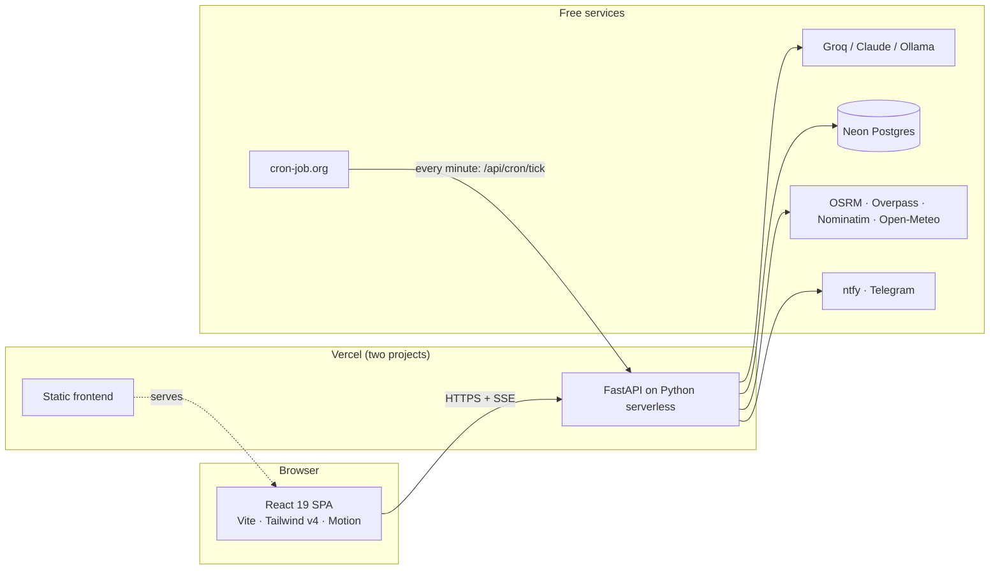
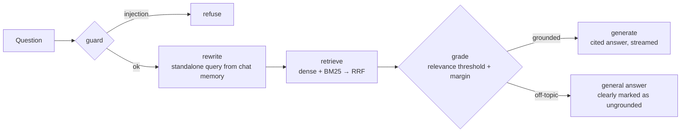

# AI Full-Stack Developer Portfolio

**Eight production-style AI products in one React + FastAPI monorepo, deployed on free-tier infrastructure.**

[Live site](https://ai-full-stack-developer-portfolio-p.vercel.app) ·
[API health](https://ai-full-stack-developer-portfolio-b.vercel.app/api/health) ·
[Roadmap](ROADMAP.md)


This is not a gallery of screenshots. Every tile on the site is a working product with its own API, persistence, tests
and failure handling. They share one backend: an LLM layer that can switch providers, a hybrid-retrieval RAG engine,
LangGraph agents and a storage layer that runs on SQLite locally and on Postgres in production.

---

## Products

| Product | What it does | Interesting engineering |
| --- | --- | --- |
| **DocuMind** | Agentic RAG over your documents, with every step visible | LangGraph pipeline (guard → rewrite → retrieve → grade → generate), hybrid dense + BM25 retrieval fused with RRF, streamed tokens and citations over SSE, live pipeline visualisation |
| **Keeper** | A personal assistant that remembers the small stuff | Natural-language intent routing (LLM with rule-based fallback), vision OCR for warranty cards and receipts, timed reminders pushed to your phone (ntfy / Telegram) with one-tap Done / Snooze, spoken alarms in the browser |
| **TripWeaver** | A trip planner that re-plans while you travel | Tool-using planner (weather, UV, air quality, places, routing), traffic-aware stop ordering via OSRM, meal slotting around opening hours, wellbeing insights, real-time group voting |
| **CareerPilot** | Job-hunt copilot | Resume-vs-JD matching with per-requirement cited verdicts, tailored documents, voice mock interviews with follow-ups |
| **MeetingMind** | Meetings in, decisions and action items out | Whisper transcription, schema-validated extraction of decisions, risks and owners, a Kanban board, RAG over past meetings |
| **FlowForge** | Drag-and-drop AI automations | React Flow canvas, typed node I/O validated before save, webhook and cron triggers, runs animated live on the canvas |
| **Evolve** | Prompts that learn from their own mistakes | Deterministic checks plus an LLM judge, failure "lessons", reflection that proposes a new prompt, promotion only after re-testing against recent inputs, versioning and rollback |
| **CodeLens** | Understand any codebase in minutes | AST and symbol-aware chunking, answers cited to files and line ranges, dependency graph, a generated guided tour |

---

## Architecture



### The RAG pipeline (DocuMind)



Each node is wrapped in a tracer, so the frontend's Pipeline Studio replays exactly what happened: timings, retrieved
chunks with their fused scores, and the route taken.

---

## Engineering decisions

**One storage abstraction, two engines.** `app/core/db.py` writes portable SQL once. Locally each product gets its own
SQLite file. When a `DATABASE_URL` is present (Neon on Vercel), the same code runs on Postgres with namespaced tables and
a PgBouncer-safe psycopg 3 connection (no server-side prepared statements). Serverless instances share no disk, so this
is what makes data survive across requests. `GET /api/health` reports which engine is live and, if it fell back, which
variable names it saw (never their values).

**Serverless-aware runtime.** The bundle is read-only and only `/tmp` is writable. Model caches and data directories are
redirected there when `VERCEL` is set. Background schedulers are switched off on serverless hosts and replaced by an
authenticated `/api/cron/tick` endpoint, which an external free cron calls every minute. Docker and local runs keep
in-process schedulers. Startup failures return a 503 with a sanitised cause instead of an opaque 500.

**Provider-agnostic LLM layer.** Groq (free tier, default), Anthropic Claude and local Ollama sit behind one interface,
selected by `LLM_PROVIDER`. Structured outputs are validated with Pydantic. Every agent has a deterministic fallback, so
a quota error degrades the feature instead of breaking it.

**Hybrid retrieval without a vector database.** FastEmbed (`bge-small-en-v1.5`, ONNX, CPU-only) produces the embeddings.
Vectors live in SQLite or Postgres and are searched with NumPy, then fused with BM25 using Reciprocal Rank Fusion
(k = 60). Removing ChromaDB kept the deployed function under Vercel's 500 MB limit with no loss of quality at this scale.

**Free-tier first.** Everything runs without a credit card: Groq, Neon, Vercel Hobby, OpenStreetMap services, ntfy
push and cron-job.org. Moving to a paid model (Claude) is a one-variable switch, and phone delivery sits behind a
small channel interface, so SMS can be added without touching the reminder logic.

**Defence in depth.** The defences are layered:
- Inputs: guardrail heuristics catch prompt injection before any tokens are spent, and retrieved context is
  delimiter-tagged in the prompt.
- Rendering: Markdown is rendered without raw HTML.
- Requests: per-IP rate limits (slowapi), a strict CORS allow-list with credentials disabled, security headers (CSP,
  nosniff, framing, HSTS in production), and an optional access key for personal data (Keeper).
- Links: one-tap reminder actions use HMAC-signed, expiring tokens.

---

## Tech stack

| Layer | Tools |
| --- | --- |
| Frontend | React 19, JavaScript (ES2023), Vite 8, Tailwind CSS v4, Motion, React Flow, Leaflet, react-markdown, Vitest, ESLint |
| Backend | Python 3.12, FastAPI, Pydantic v2 / pydantic-settings, LangGraph, LangChain core, uvicorn, slowapi |
| AI | Groq (gpt-oss-120b, Whisper, vision), Anthropic Claude, Ollama, FastEmbed, rank-bm25 |
| Data | Neon Postgres (psycopg 3), SQLite, NumPy |
| Infra | Vercel (frontend and Python functions), Docker (multi-stage, non-root), GitHub Actions, cron-job.org |
| External APIs | OSRM, Overpass / Nominatim (OpenStreetMap), Open-Meteo, ntfy, Telegram Bot API |

---

## Repository layout

```
.
├── backend/
│   ├── app/
│   │   ├── api/          # HTTP routers: core RAG, products, keeper, cron
│   │   ├── core/         # db abstraction, doc store, security, logging, TLS
│   │   ├── rag/          # ingestion, embeddings, hybrid retriever, LangGraph pipeline, guardrails
│   │   ├── keeper/       # agent, parser, reminders, notify (ntfy/Telegram), vision
│   │   └── products/     # careerpilot, codelens, evolve, flowforge, meetingmind, tripweaver, travel
│   └── tests/            # pytest suite (unit + API + agent flows with fake LLMs)
├── frontend/
│   └── src/
│       ├── site/         # landing page, product pages, command palette
│       ├── products/     # one folder per product app
│       ├── components/   # chat, pipeline studio, shell
│       └── lib/          # API client, SSE parser, layout helpers
├── documents/            # files DocuMind indexes on startup
├── index.py              # Vercel entry point (guarded ASGI wrapper)
├── Dockerfile            # single-container build: SPA + API
└── docker-compose.yml    # optional local Ollama profile
```

---

## Running locally

**Prerequisites:** Python 3.12, Node 22.12+, and a free [Groq API key](https://console.groq.com/keys).

```bash
# 1. Configuration
cp .env.example .env            # set GROQ_API_KEY; every other setting has a safe default

# 2. Backend  →  http://127.0.0.1:8000  (OpenAPI docs at /docs)
cd backend
python -m venv .venv && source .venv/bin/activate   # Windows: .venv\Scripts\activate
pip install -r requirements-dev.txt
uvicorn app.main:app --reload

# 3. Frontend  →  http://localhost:5173
cd frontend
npm install
VITE_API_BASE_URL=http://127.0.0.1:8000 npm run dev  # omit to use the deployed API
```

**Or in one container:** `docker compose up --build` serves the SPA and API on <http://localhost:7860>.
Add `--profile local-llm` to run fully offline with Ollama.

### Quality gates

```bash
cd backend  && ruff check . && ruff format --check . && pytest   # 115 tests
cd frontend && npm run lint && npm test && npm run build        # 19 tests
```

CI runs the same gates on every push, then builds the Docker image.

---

## Deployment (Vercel, free tier)

The frontend and backend are **two Vercel projects** from this one repository.

| Project | Root | Notes |
| --- | --- | --- |
| Frontend | `frontend/` | Vite preset; SPA rewrites in `frontend/vercel.json` |
| Backend | repository root | `index.py` exposes the FastAPI app as a Python function |

Backend environment variables:

| Variable | Required | Purpose |
| --- | --- | --- |
| `GROQ_API_KEY` | yes | Default LLM, Whisper and vision provider |
| `DATABASE_URL` | yes on Vercel | Neon Postgres. Connecting the Neon store to the backend project sets it automatically |
| `CRON_SECRET` | for reminders | Protects `/api/cron/tick`. Point a free every-minute job at it with `Authorization: Bearer <secret>` |
| `CORS_ORIGINS` | no | Extra allowed origins. The frontend's Vercel domains and localhost are always allowed |
| `KEEPER_ACCESS_KEY` | recommended | Locks Keeper's personal data behind a key |
| `ANTHROPIC_API_KEY`, `LLM_PROVIDER` | no | Switch the LLM to Claude |

After deploying, `GET /api/health` should report `"storage": "postgres"`.

---

## Roadmap

See [ROADMAP.md](ROADMAP.md). Next up for TripWeaver: reservation and food-ordering deep links, group cost splitting
and a shared trip wallet.
