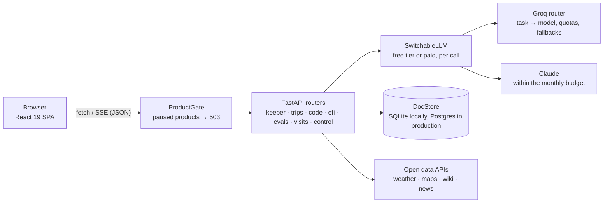

# How it works

This is the explainer for the whole application: what happens on a request, how the backend and frontend are put
together, and the methods behind the parts people ask about (the card shuffle, the product strip, Tara's routing, the
evals). It is written for engineers and for walking someone through the code. File paths are relative to the repository
root.

- [1. The big picture](#1-the-big-picture)
- [2. Frontend](#2-frontend)
  - [2.1 App shell: routing, code splitting, skins and themes](#21-app-shell-routing-code-splitting-skins-and-themes)
  - [2.2 The product catalogue](#22-the-product-catalogue)
  - [2.3 The personal space: motion methods](#23-the-personal-space-motion-methods)
  - [2.4 Tara in the browser](#24-tara-in-the-browser)
  - [2.5 Quality, Insights and the control room](#25-quality-insights-and-the-control-room)
  - [2.6 Safarnaama and CodeLens in the browser](#26-safarnaama-and-codelens-in-the-browser)
- [3. Backend](#3-backend)
  - [3.1 The application and its middleware](#31-the-application-and-its-middleware)
  - [3.2 The model layer: router, switch and budget](#32-the-model-layer-router-switch-and-budget)
  - [3.3 Tara's pipeline: understand, act, respond](#33-taras-pipeline-understand-act-respond)
  - [3.4 Retrieval (RAG) and confidentiality](#34-retrieval-rag-and-confidentiality)
  - [3.5 Evaluations, history and security controls](#35-evaluations-history-and-security-controls)
  - [3.6 Visits, reminders and code proposals](#36-visits-reminders-and-code-proposals)
  - [3.7 Identity, sign-in and per-person data](#37-identity-sign-in-and-per-person-data)
  - [3.8 Safarnaama: the right place, and money](#38-safarnaama-the-right-place-and-money)
  - [3.9 CodeLens hand-over document](#39-codelens-hand-over-document)
  - [3.10 CodeLens hand-over readiness](#310-codelens-hand-over-readiness)
  - [3.11 Safarnaama's travel guide and what a trip will cost](#311-safarnaamas-travel-guide-and-what-a-trip-will-cost)
  - [3.12 Live hotel prices and booking (LiteAPI)](#312-live-hotel-prices-and-booking-liteapi)
- [4. Running and testing it](#4-running-and-testing-it)
- [5. What's next for Tara](#5-whats-next-for-tara)

---

## 1. The big picture



Two Vercel projects serve it: the frontend is a static build (`frontend/`), the backend is FastAPI running as a Python
serverless function (`index.py` wraps `backend/app/main.py`). Locally the same code runs as `uvicorn` + `vite`.

Three rules shape everything:

1. **Nothing made up.** Numbers on the site come from stored runs or the product registry; Tara hands trips to
   Safarnaama (real places and weather) instead of inventing an itinerary; client names are never shown.
2. **Free by default, safe when paid.** Every model call goes through one switch: Groq's free tier unless the owner
   turns on a paid provider, and then only within a monthly budget.
3. **Works on modest devices.** Animations move only `transform` and `opacity`, pause off-screen, and switch off for
   reduced motion or "lite" devices.

---

## 2. Frontend

React 19, Vite, Tailwind CSS v4 and Motion (`motion/react`). Shared primitives live in `packages/web-core`
(`@appcore/web`: router, HTTP/SSE helpers, light/dark mode).

### 2.1 App shell: routing, code splitting, skins and themes

- **Router** (`packages/web-core/src/router.jsx`, used in `frontend/src/Root.jsx`). A small History-API router: `usePath()`
  re-renders on `popstate`; `Link` pushes state. `Root.jsx` maps paths to pages; old names redirect (`/tara` → `/keeper`,
  `/tripweaver` → `/safarnaama`, `/preview/playful` → the personal space).
- **Code splitting.** Every product app and every page except the home page is `React.lazy`: a visitor to the home page
  never downloads CodeLens or the Quality page. The personal space is its own chunk too (Studio visitors never fetch it,
  or its font). Skeletons (`components/Skeleton.jsx`) fill the gap while a chunk loads.
- **Two skins of the home page** (`theme/skin.js`, `theme/theme.js`). `data-skin` on `<html>` is `showcase` (the
  **Studio**, calm and recruiter-first, the default) or `personal` (**Off the clock**, the playful personal space). The
  switch (`theme/SkinSwitch.jsx`) persists the choice and animates with the View Transitions API where available.
- **Light / dark.** `data-theme` on `<html>`: light, dark, or automatic by local time. Components read colours from CSS
  variables, so a theme change is a repaint, not a re-render.
- **Lite mode** (`lib/lite.js`). Turned on for reduced-motion users, low-memory or low-core devices, data-saver, or when
  the first seconds run under 40 fps. It sets `data-lite` (CSS turns off blur and ambient animation) and makes
  `MotionConfig` reduce motion. `?lite=1` / `?lite=0` force it for testing.
- **Search** (`site/CommandPalette.jsx`): Ctrl/⌘ K anywhere, to jump to a product or page, switch skin, or change
  light/dark mode.
- **Visit analytics** (`lib/visits.js`): one cookie-free beacon per page view (see 3.6); never from localhost, Do Not
  Track, or the owner's own browser.

### 2.2 The product catalogue

**One registry, everything derived.** `frontend/src/site/products.js` holds every product once: id, name, the problem
it solves, the outcome, status, visibility, app route, screenshot key and stack.

- `PORTFOLIO` = the featured products (`visibility: 'portfolio'`), sorted by `priority`. Its length is the product
  count shown anywhere on the site; nothing is typed in by hand.
- `FROZEN` = products shown as "in development" (not clickable, code kept and reused).
- **Statuses** follow one rule: *Live* only when the main workflow works end to end, persists, is access-controlled and
  tested; otherwise *Beta* or *In development*. `products.test.js` checks the rules (and that no client is named).
- **Problem-first framing.** Cards lead with the problem ("Planning a trip means juggling a dozen tabs?") and the
  outcome, then *Try it* (the app route) and *Details* (the product page at `/products/<slug>`).
- **Screenshots** are pre-rendered `public/projects/<key>.webp` files, lazy-loaded; a product without one falls back
  to a coloured tile.

The same registry feeds the Studio (`site/ShowcaseHub.jsx`: a sticky product story and a sideways "in development"
shelf), the personal space (2.3), product pages, search, and Tara's product hand-off list on the backend (3.3).

### 2.3 The personal space: motion methods

`frontend/src/site/personal/PersonalSpace.jsx`. Bright, condensed type (Oswald), playful motion. Four principles apply to
every effect:

1. **Compositor-only properties.** Only `transform` and `opacity` animate, so the browser can move layers on the GPU
   without layout or repaint. Moving cards carry `will-change: transform`.
2. **Motion values, not React state, for anything tied to the pointer or the scroll.** `useScroll`, `useMotionValue`
   and `useTransform` update styles directly; React does not re-render while you scroll or swipe.
3. **Pause what you can't see.** `useInView` gates every loop (the deck shuffle, the panning screens).
4. **Respect the device.** With reduced motion or lite mode, `still` is true: loops stop, scroll-linked effects rest at
   their final state, and `MotionConfig` makes the rest instant.

#### The card shuffle (the hero deck)

A small **state machine in `useReducer`**:

```
state = { order: [card ids, back → front], tossing: id | null, dir: ±1 }

toss    → if nothing is flying, mark the front card (order.at(-1)) as tossing; alternate the direction
landed  → move the tossed card to the start of `order` (the back of the stack); tossing = null
shuffle → rotate `order` by two (a click)
```

- **Fan geometry.** Each card's slot is its position in `order`, centred: `c = pos − (n−1)/2`. Its target is
  `x = c × 66px`, `rotate = c × 6.5°`, `y = |c| × 10px` (outer cards sit a little lower). Hovering the deck sets
  `spread`, widening it to `128px` and `11°`. Everything scales with the screen (`s = min(1, width / 760)`).
- **The toss.** While a card is `tossing`, its target becomes "fall down and away": `x = dir × 160`, `y = 420`,
  `rotate = dir × 32°`, `scale = 0.9`, with an **ease-in** curve (`[0.55, 0, 0.8, 0.4]`, accelerating like a drop) over
  0.55 s. When that animation completes, `landed` moves it to the back. Its `z-index` becomes the lowest, and the normal
  **spring** (`stiffness 260, damping 22`) carries it back up *behind* the others. That spring is the "tucks into the
  back" motion.
- **Auto play.** A `setInterval` dispatches `toss` every 2.6 s, but only while the deck is on screen, the tab is
  visible, and nobody is hovering or dragging it.
- **Fling it yourself.** Only the front card is draggable (`drag`, `dragSnapToOrigin`, elastic 0.6). On release, if it
  moved more than 90 px or faster than 600 px/s, it is tossed in the direction you threw it; otherwise it springs home.
- **The lean.** A window `pointermove` listener maps the cursor to −1…1 in two motion values. `useTransform` maps those
  to `rotateY ±10°` / `rotateX ±8°`, smoothed by springs, on a container with `perspective: 1000px`.

#### The product strip (Featured work)

A **native horizontal scroll container with CSS scroll-snap**, so swiping is the browser's own (smooth on any device),
with the look computed from the scroll position:

- **Layout.** `display: flex; overflow-x: auto; scroll-snap-type: x mandatory`; each card `scroll-snap-align: center`
  and `scroll-snap-stop: always` (one product per swipe). Side padding of `(viewport − cardWidth) / 2` lets the first
  and last cards reach the centre. Card width `W = min(420px, 72vw)`, gap `0.14 W`, step `= W + gap`.
- **The tilt.** `useScroll({ container })` gives `scrollX`. Each card computes its distance from the centre in cards:
  `d = i − scrollX / step` (0 = centred). From `d`: `rotate = clamp(d, ±1.4) × 10°`, `y = min(|d|, 1) × 30px`,
  `scale = 1 − min(|d|, 1) × 0.12`. Centred cards stand upright; neighbours tilt away and sink.
- **Which one is centred** (for the live screen and labels): `round(scrollX / step)`, updated by `useMotionValueEvent`.
  React only re-renders when that whole number changes.
- **Mouse drag.** Touch and trackpads scroll natively. For a mouse, a press only becomes a drag once the pointer has
  moved more than 6 px. Only then does the strip capture the pointer and turn snapping off, and `pointermove` sets
  `scrollLeft` directly. On release it scrolls smoothly to the nearest step and snapping is restored. A plain click is
  never captured, so *Try it* and *Details* open normally; only the click that ends a real drag is swallowed. (Capturing
  on press, as an earlier version did, sent every click to the strip instead of the link, so no product opened.)
- **The live screen.** The centred card's screenshot is 125% tall and pans `0 → −16%` and back over 9 s, like a screen
  recording. Only the centred card pans, and only while on screen.

#### The other effects

| Effect | Method |
| --- | --- |
| Name and headings rise word by word | Each word sits in an `overflow: hidden` span; the inner span animates `y: 105% → 0` with a stagger of 0.08 s per word. Letters of the name spring up on hover (`stiffness 500, damping 12`). |
| Role line fills in as you scroll | Two layers per word (grey below, dark above). The dark layer's `opacity` maps to that word's slice of the line's scroll progress (`useScroll` with offsets `start 0.85 → end 0.4`). |
| Skill cards drop in | An under-damped spring (`stiffness 140, damping 11`) from `y: −280` gives the bounce; cards are staggered by 0.12 s, then their tool chips pop in one by one. |
| Tech names stream past | A CSS `@keyframes` loop of `translate3d(−50%)` over a duplicated row, so it runs on the compositor with no JavaScript per frame. The fading edges are two fixed gradient overlays, not a CSS mask: a mask over moving content forces a repaint every frame, and was the main source of lag. |
| In-development cards | Flip in with `rotateY: −80° → 0` (perspective on the grid); on hover the back card fans out and the screenshot pans. |
| CONTACT stretches up | `scaleY` maps the footer's scroll progress (`start end → end end`) from 0.08 to 1, anchored at the bottom; each letter squashes and stretches on hover. |
| Palette button | Swaps the four card colours. Text on a card uses `inkOn(colour)`, the WCAG relative-luminance formula, to pick white or near-black. |
| Dark mode | All colours are CSS variables on `.pl-root`, redefined under `html[data-theme="dark"]`. |
| Links from other pages | `/#experience` from the Quality page: this space loads lazily, so after mount it scrolls to `location.hash` once the section exists. |

It also carries everything the rest of the site offers:
- **Navigation:** section links, search, theme and the switch to Studio.
- **Your details:** local time, social links, availability, at-a-glance numbers, industries (never client names) and "Right now" notes.
- **Products:** *Try it* / *Details* on each card, with Live/Beta labels.
- **Experience:** each role expands to its details.
- **Contact and help:** the contact form, the "Ask Tara about my work" chat, scroll progress, back-to-top and a skip link.

### 2.4 Tara in the browser

`frontend/src/products/keeper/`.

- **Voice** (`voice.js`): one continuous speech-recognition session handles both "Hey Tara" and the request, so nothing
  is lost between the wake word and the question. End-of-speech detection waits ~1.8 s of quiet, or ~3.5 s if the sentence
  ends on a dangling word ("and…", "to…"). Speech out uses the browser's voices; the user's choice of voice, speed and
  pitch is stored on the device (`prefs.js`).
- **Personal settings by voice.** "Use a female voice" or "speak slower" returns a `settings` action that `applySetting`
  applies on the device. No owner key is involved.
- **Cards** (`Cards.jsx`): every action is a card with a button (open, call, message, timer, edit proposal). Product
  hand-offs show *Plan it* / *Open* and open inside the site.
- **Installable**: `keeper.webmanifest` + `sw.js` make it a PWA. `android/` wraps it as a Trusted Web Activity (the
  APK is built by `.github/workflows/tara-android.yml`).
- **Conversations** (`chats.js`): the chat on screen is one of a list kept in this browser only (25 at most, 40 turns
  each, trimmed to what's needed to show them again). It's a tiny external store read with `useSyncExternalStore`, so
  the sidebar's *Recent* list and the thread stay in step. *New conversation* sits at the top of the sidebar and in the
  phone header; the phone header also opens the list. Each signed-in account gets its own list (keyed by a short hash
  of the email, never the email). Switching chats uses React's "adjust state while rendering" pattern, so the old
  thread never flashes; an answer still on its way when you switch is filed with the chat it belongs to.

#### Tara in the personal space

Only when the site is in the personal skin (`useSkin() === 'personal'`); the Studio keeps the quieter look.

- **The sky** (`Sky.jsx`): the real weather where you are (or your home city) and the time of day. `sceneOf()` maps
  the WMO weather code to a scene (clear, cloudy, fog, drizzle, rain, snow, storm); `dayPhase()` gives dawn, day,
  dusk or night. Gradients, the sun glow, the moon and drifting clouds are CSS (transform and opacity only). One
  canvas draws rain, snow or twinkling stars at about 30 fps and sleeps when the tab is hidden; a storm adds a flash at
  random every 5 to 14 seconds (Web Animations). Lite mode keeps the colours and drops the motion.
- **The HUD** (`Hud.jsx`): SVG rings around the orb, turned by CSS at different speeds. The inner arc races while Tara
  thinks and swells while she listens. Four read-outs: local time (updated on the minute), the weather, what's due
  and status.
- **Background music** (`ambient.js`): slow, soothing sound generated with Web Audio, so there are no tracks to
  license or download. Five sounds: calm pads (a Cmaj9 → Am9 → Fmaj7 → G6 loop with slow swells), soft piano
  (pentatonic bell notes over a quiet pad), rain (filtered noise plus random drops), night (a deep drone with distant
  chimes) and ocean (brown noise with a 10-second swell). *Match the weather* picks one from the sky (rain → rain,
  a clear night → night). All of it runs through a generated reverb into one master gain. Music goes silent while
  Tara listens (so the microphone hears you) and dips while she speaks. Browsers only allow sound after a tap, so if
  it was left on it starts on the first one. "Play some calm music" and "stop the music" are handled on the device,
  with no server round trip. Settings: *Voice & personality → Background music*, or the music button in the composer.
- **Brief me**: a spoken summary built from what's already on screen (greeting, weather, what's due). Optionally it
  plays once per visit on the first tap.
- **Try saying** becomes an endless, slow stream of ideas (the same CSS loop as the tech names in the personal space).

### 2.5 Quality, Insights and the control room

- **Quality** (`site/QualityPage.jsx`, `/quality`).
  - **Runs:** the "Run app checks" button runs every deterministic suite in one request. "Run with live model" runs each model suite in its own request: if the free tier cut a pass short, the next pass asks only the refused cases, up to three passes.
  - **Cards:** each suite shows its score with a 95% interval, macro-F1 or ranking metrics, a trend line, the change since the last run, and a regression flag.
  - **History:** a chart (with the interval as a band) and a table of every run.
  - **Security:** a panel lists each control and the standard it answers to.
- **Insights** (`site/InsightsPage.jsx`, `/insights`, owner key): visits, sources, products, devices, advice computed
  from those numbers, and tagged share links.
- **Control room** (`site/ControlPage.jsx`, `/control`, owner key): the AI provider and budget, product switches, Tara's
  switches, and the change history (see 3.2).

### 2.6 Safarnaama and CodeLens in the browser

**Safarnaama** (`products/safarnama/web/src/`).

- **70 places** (`choices.js`): India and abroad, each with its nearest airport, best months, a one-line hook, and
  for Indian places the state (sent to the planner so a namesake can't win; see 3.8). The first step lists six in
  season, with search (by name, then state or country, then theme; accents ignored) and filters (India, Abroad,
  Beaches, Hills, Heritage, Spiritual, Food). Anything not listed can still be typed. Every name was checked against
  the geocoder. Places without a bundled photo show their colour tile.
- **In the personal space** (`skin.js`, `usePersonal()` watches `<html data-skin>`), Safarnaama is budget-first:
  tell it where, when, who and the budget, and it lays out the whole trip.
  - **The personal space's look.** Plain paper (or near-black), Oswald uppercase headings, ink pills and bright,
    slightly tilted colour cards in the personal space's palettes; the same palette button recolours them
    (`PaletteButton.jsx`, saved per browser). It re-maps the colour tokens the light theme uses on
    `<html data-pa-theme="personal">` and restyles the shared primitives through stable `ui-*` class hooks
    (`packages/web-core/src/ui.jsx`: `ui-card`, `ui-tab`, `ui-btn-primary`…), so no product component carries its own
    copy of the theme. The trip hero, the wallet, the budget plan, places and trips are colour cards like the personal
    space's.
  - **The budget step.** The last Quick Plan step leads with the budget: one number for the whole trip, or a spending
    level (easy, comfortable, treat yourselves: a person a day × people × days) that fills it in, and optionally where
    the trip starts (for the fares to get there). The planner then plans to that level (see 3.8).
  - **The trip is a guidebook, not tabs** (`Guidebook.jsx`): one page a traveller scrolls like a local guide talking
    them through the trip, with sticky chapter pills (Stay · Days · Eat · Do · Getting around · Money · Take it):
    - **What it'll likely cost:** the total at the chosen stay level (stay, food, getting around, things to do,
      getting there) against the budget, with "fits", "tight" or "over by"; it moves as the level changes.
    - **Pick your kind of stay:** Budget / Comfort / Treat, each with what a room usually costs a night there and the
      whole trip at that level; the areas to stay in and why; the booking sites with the dates; **live prices** for
      the trip's own dates and guests (3.12), each hotel placed in a stay level, with "Book"; real places to stay near
      the plan (OpenStreetMap) of the chosen kind, to shortlist.
    - **Your days:** swipeable day cards with the weather, every stop with what it usually costs, a tap for the note,
      directions and "mark done"; the map shows the day in view. Editing the plan sits behind one fold.
    - **The food haul:** dishes and the real places they're known at, popular or a local pick, with the cost a person.
    - **Adventure, culture and local life:** filterable cards with cost, time, best time and a tip; *Surprise me*
      picks something not yet planned. Any food place or thing with a map pin goes into a day in one tap ("Add to
      day", the lightest day suggested), keeping its usual cost.
    - **Getting there and around:** fares for the ways to get around, local tips, and the ways to get there from the
      starting city (asked in the planner, or added here).
    - **Money** (wallet, budget plan, expenses) and **Take it with you** (the trip pack, bookings and documents).
    Costs are typical prices for the season from the guide (3.11), marked with ≈ and never shown as live prices.
  - **The trip pack** (`packHtml.js`, `TripPack.jsx`): everything in one self-contained web page to download, print
    or save as a PDF, or share from a phone (Web Share with the file). What it'll likely cost, the guide's stay levels,
    food haul, things to do and fares, the budget plan, the day-by-day plan with map
    links and the forecast as fetched, where to stay (shortlisted first, then nearby, with dated search links), things
    to do nearby (places with a Wikipedia entry first: a fact on the map, not a rating), saved places, bookings (titles
    and dates, never reference numbers), checklists and tips. No scripts or remote assets; text is escaped and only
    https links are kept. A part that can't be fetched is left out rather than failing the pack.
  - **Less to read:** the version history is hidden, the voting name only appears when someone votes, and adding
    stops or re-planning sit behind one *Change the plan* button. The detailed expense form folds under the wallet.
- **Booking hand-offs** (`booking.js`): pre-filled searches on the providers' own sites, each marked with what was
  checked in a browser. Google Hotels ignores date parameters and reads the guest count from neither the link nor the
  text, so its link writes the dates into the search ("hotels in Goa from 14 December 2026 to 17 December 2026") and
  the traveller sets the guests there. Google Flights reads place, dates and passengers from the text. Airbnb,
  MakeMyTrip, Booking.com and GetYourGuide refuse automated browsers, so their links say dates may need re-entering.
  A trip's last day is the day you leave: a 4-day trip is 3 nights, the same count the budget plan uses.

**CodeLens**: *Hand-over document* on a repo's page offers Markdown (for wikis and GitHub), a self-contained web
page, or print / save as PDF (the page opened in a new window with print styles). The *Ready to hand over?* chapter
shows the readiness report (score, checks with evidence, risks, the module map, a meeting plan and starter files to
download). See 3.9 and 3.10.

---

## 3. Backend

FastAPI with Pydantic v2 (`backend/app`), the shared core in `packages/py-core` (`appcore`), Safarnaama's API in
`products/safarnama/api`.

### 3.1 The application and its middleware

`create_app()` in `backend/app/main.py` builds the app.
- **Startup (lifespan).** It loads the retrieval service, ingests `documents/`, creates the control room, wraps the model factory in the switch, and starts Tara, Safarnaama and Jasoos.
- **Middleware**, from the outside in:
  1. Security headers (nosniff, referrer policy, CSP, no-store for API responses).
  2. CORS: only the site's own origins; credentials are never allowed.
  3. GZip, except live event streams.
  4. Errors returned as JSON.
  5. **ProductGate**: a product paused in the control room answers 503.
- **Rate limits** (`slowapi`) sit on every endpoint that costs money or can be abused.
- **Storage.** `appcore.docstore.DocStore` is one JSON document table that runs on SQLite locally and Postgres (Neon) in production, chosen by `DATABASE_URL`.

### 3.2 The model layer: router, switch and budget

- **The Groq router** (`packages/py-core/src/appcore/llm/router.py`). Code asks for a *task* (`keeper.command`,
  `codelens.ask`…), never a model.
  - **Classifying:** each task has a complexity class.
  - **Choosing a model:** it picks the smallest free model that can do the job well. It never goes below a task's minimum tier, and an "overkill" penalty keeps big models free for big jobs.
  - **Quotas:** it tracks each model's per-minute and per-day limits from response headers.
  - **When refused:** it waits for a short `retry-after` or falls back to another model.
- **The switch** (`backend/app/control.py`, `SwitchableLLM`). Wraps the router. On every call it reads the control room:
  - **Default:** Groq's free tier.
  - **Paid:** Claude (Haiku / Sonnet / Opus 5.5, with the chosen effort), but only when all four hold:
    - the owner chose it;
    - the product is in the "paid for" list;
    - this month's spend is under the budget;
    - the key is set on the server.
  - **Metering:** token counts from each response are priced and added to the monthly total.
  - **Falling back:** over budget, or if Claude fails, the call quietly falls back to Groq.
  - **Evals stay free:** they set a `FREE_ONLY` context variable, so a public "Run with live model" never spends money.
- **The control room's settings** are a strict Pydantic schema.
  - **Fixed choices:** providers, models and effort levels come from a list; numbers are bounded; unknown fields are refused.
  - **Kept off it on purpose:** secrets and security settings (CORS, the owner key, rate limits).
  - **Change history:** each save stores a from → to diff.
  - **Caching:** settings are cached for 10 s per process, so changes apply within seconds across serverless instances.

### 3.3 Tara's pipeline: understand, act, respond

`backend/app/keeper/agent.py` is a LangGraph graph of three nodes.

**1. Understand.** In order:
- **Offline rules** (`parser.py`, `tools.py`) parse the message, so Tara still works when the model is down. A tool
  request ("weather in Pune") beats the "X is in Y" storage pattern.
- **Products first** (`rule_product`). Requests one of the site's products is built for go to it:
  - trips, itineraries, places to visit, getaways → Safarnaama, with the place read from the words, or the home city
    for "nearby";
  - a GitHub repo → CodeLens;
  - a failing build or stack trace → Jasoos.
  - Naming a product about an earlier request ("why didn't you use Safarnaama?") hands that request over. A short "yes /
    do it / I want one" after Tara mentioned a product accepts the offer without calling the model.
- **The model router.** It gets a system prompt with the tools, the product inventory, the 20 expert personas and the
  conventions, plus the last few turns. It returns one JSON command (action, tool and args, mood, persona), validated
  by Pydantic.
- **Guards after the model.**
  - "Change your voice" is a personal setting, never a code change.
  - If the model chose chat, web search or directions for a product's job, the product wins.
  - The travel-planner persona answering in chat means Safarnaama.
  - The place read from the user's words beats the model's guess; "nearby" is never a destination.

**2. Act.** It saves or finds the user's things (reminders, bills, where things are), calls a look-up tool (weather, news,
wiki, rates, the site's own code or documents), or builds a device action (open, call, message, timer, a product
hand-off with its link already filled in, e.g. `/safarnaama?to=Bengaluru`).

**3. Respond.** The chosen persona's brief and the user's tone and length set the answer.
- **Sources:** look-up results are the only facts allowed.
- **Never invented:** it never makes up the user's data, itineraries, prices or opening hours.
- **Feelings:** they shape the wording, and a crisis message always gets a safety response first.

### 3.4 Retrieval (RAG) and confidentiality

- **Ingestion** (`backend/app/rag/ingestion.py`). It loads `documents/`, chunks the text, embeds it with FastEmbed and
  upserts the chunks.
  - **Incremental:** only files whose hash changed are re-indexed.
  - **Client names removed first:** before chunking, they are replaced with neutral descriptions
    (`rag/redact.py`).
  - **Re-indexing after a rule change:** the stored hash includes the redaction rules' version, so changing the rules
    re-indexes everything once.
- **Retrieval** (`rag/retriever.py`). BM25 and dense vectors, fused with reciprocal rank fusion.
- **Pipeline:** a LangGraph pipeline adds a prompt-injection guard, query rewriting with chat memory, and answers
  with citations.

### 3.5 Evaluations, history and security controls

`backend/app/evals.py`; the Quality page is its UI.

- **App checks** run the real code paths on labelled sets: Tara's offline rules and device actions, CodeLens retrieval,
  Safarnaama place detection, Jasoos log parsing, JSON recovery and the security controls.
- **Model evals** call the live model on labelled sets (routing, emotion, persona).
  - **What's scored:** only cases the model actually answered; a refused call is "not measured", never "wrong".
  - **Pacing:** calls run one at a time and honour the provider's retry hints.
  - **Resuming:** a partial run can be continued for just the refused cases.
- **Statistics enterprises use.**
  - **Accuracy:** with a 95% **Wilson interval**, so a small set says how sure it can be.
  - **Labelling tasks:** **macro-F1** with per-label precision and recall.
  - **Retrieval:** **hit@1 / hit@3**, **MRR@10** and **nDCG@3**.
  - **Latency:** p50 / p95.
  - **Reliability:** coverage and fallback rate.
  - **Standards:** each suite names the categories it measures (ISO/IEC 25010, NIST AI RMF; aligned with, not
    certified).
- **History.** Every run is stored under its own id. `/api/evals/latest` adds each suite's last 12 values, the change
  since the previous run, and a **regression** flag for a drop of 5 points or more; `/api/evals/history` returns every
  run.
- **Security suite** (13 controls, each exercised against the running app and mapped to OWASP Top 10 for LLM apps,
  OWASP API Top 10, ISO 25010 and NIST AI RMF):
  - owner-only APIs refuse anyone without the key;
  - no secret appears in any public response;
  - other websites can't call the API from a browser (CORS);
  - security headers are on every response;
  - oversized input is refused;
  - rate limits sit on costly routes;
  - code proposals can't touch protected paths;
  - a tampered proposal is refused;
  - prompt injection is blocked;
  - client names are never shown;
  - paid spend is capped;
  - trips aren't made up;
  - visit analytics stay private.

### 3.6 Visits, reminders and code proposals

- **Visits** (`backend/app/visits.py`).
  - **No cookies, no IPs stored:** a visitor is a salted hash of (day, network, browser) that changes daily.
  - **What's kept:** only the path, the referring site, the screen-width class and the tag on the link that brought the visitor (`?ref=linkedin`).
  - **Bots** are dropped.
  - **The owner's summary** compares this period with the last, and gives advice that quotes the numbers it rests on.
- **Reminders.** An external scheduler calls `/api/cron/tick` with a shared secret. Due reminders go out by ntfy or
  Telegram, and a heartbeat shows when it last ran.
- **Code proposals** (owner only). Tara plans an edit; the plan is **HMAC-signed** and expires after 30 minutes. When the owner
  approves, the backend re-checks it:
  - **Signature:** it must match.
  - **Protected paths:** never secrets, CI or deployment files, and never outside the repository.
  - **One at a time:** one open proposal at once.

  It then starts a GitHub workflow that opens a pull request, and a review job checks it. Branch protection means only a
  human merge reaches `main`.

### 3.7 Identity, sign-in and per-person data

Every product keeps each person's data apart. `backend/app/identity.py` decides who is calling, in this order:

1. **The site owner:** a valid owner key (`X-Tara-Owner-Key`), sent from the owner's own browser once it has been
   unlocked in Insights, the control room or Tara.
2. **A signed-in account:** Google or an emailed link through Neon Auth. The browser sends the short-lived JWT as
   `Authorization: Bearer …`; the server verifies it against Neon's public keys (`appcore.accounts`).
3. **A browser:** a random id the browser makes once (`X-Visitor`, from `packages/web-core/src/identity.js`).

Only hashes are used as ids; tokens, JWTs and user ids are never stored, and nothing in a request body can choose who
you are.

- **Tara:** every row has an `owner` column (added without touching existing rows, which become the owner's). Each
  request sets whose data it is in a context variable (`app.keeper.store.OWNER`), and every read and write filters on
  it. Even with another person's entry id you get 404. Work outside a request (the reminder tick, the morning brief)
  sees only the owner's data, so phone pushes are the owner's alone; other people's reminders ring inside Tara.
- **CodeLens:** each repository records who indexed it. "All repos" lists only yours and only you can delete yours;
  a repo's link still opens for anyone (share it with a new joiner). Indexed code is public GitHub code.
- **Jasoos:** signed in, investigations belong to the account; otherwise to this browser's owner token.
- **Safarnaama:** trips work the same way (it was the first to have sign-in).
- **FlowForge:** a flow's Tara step saves into the Tara of whoever runs the flow; webhooks have no caller and use the
  owner's.
- **One sign-in for everything.** The Neon Auth client lives in `packages/web-core/src/account.js`, shared by every
  product, so signing in anywhere signs you in everywhere. The **Sign in** button sits in every product header and in
  Tara's sidebar (`frontend/src/site/AccountButton.jsx`). It's optional: everything works without it, for that browser.
- **Claiming.** On signing in, `claimAll()` asks Tara, CodeLens and Safarnaama to move what this browser made into the
  account (`POST /api/keeper/claim`, `/api/code/claim`, `/api/trips/claim`), so it follows you to every device.
- **In-development apps** (CareerPilot, FlowForge, Evolve, MeetingMind) still keep one shared store, so they are paused
  by default (the control room can open them for a demo) and their pages say so.

### 3.8 Safarnaama: the right place, and money

`products/safarnama/api/src/safarnama/service.py` → `Tools.geocode_city(name, country, region)`.

- **Never another country.** Results are kept only when the country matches, compared through aliases
  (`same_country`): "Netherlands" is Open-Meteo's "The Netherlands", "UK" is "United Kingdom", "Turkey" is "Türkiye".
  Nominatim is asked for English names (`accept-language=en`), or it answers "Nederland". Before this, planning
  Amsterdam failed with "Couldn't find it on the map".
- **The state settles namesakes.** The planner's request has a `region` (the curated list sends it; the model fills
  it for well-known places). With a region, a town in that state wins over a bigger one elsewhere: "Manali" alone is a
  Chennai suburb of 35,000 people, before the Himachal hill town of 8,000.
- **Then size, then spelling.** Among real towns (a seat, or 5,000+ people), the biggest wins. Among towns of about
  the same size, the one spelled exactly as asked wins (GeoNames has two Mahabaleshwars of about 13,500 people; the
  hill station is the one without the accent).
- **Then OpenStreetMap**, which knows states and regions ("Goa" is a state, so Open-Meteo only has villages).
- **Money:** `POST /api/trips/plan` takes `budget` and `currency`. The trip keeps them, in the traveller's currency
  (rupees in Bali too); otherwise it uses the destination's currency. The planner is told the budget and what it
  comes to a person a day, and plans to that level (free and good-value places when it's tight), never stating prices.
  The prompt also says not to assume a diet nobody asked for, and never to claim what a business offers (menus,
  Wi-Fi, prices, ratings). If an older server ignores the budget, the web app sets it on the new trip straight after.
- **The budget split** (`logic.split_budget`): a budget starts split across the expense categories (stay, getting
  there and around, food, things to do, shopping, and a buffer), in whole units that add up to the total, with a
  bigger share for getting there when the trip is abroad; a day trip has no stay. It is a plan for the traveller's
  money, not a price. The split follows the total until the traveller changes a line (`budget.split` goes from
  `auto` to `own`); the budget summary reports each category's budget, spend and bookings against it.
- **Places to stay** come from the `stay` discovery group (OpenStreetMap hotels, guest houses, hostels, apartments,
  chalets): name, kind, distance, website, and stars only when mapped.

### 3.9 CodeLens hand-over document

`backend/app/products/handover.py`, served by `POST /api/code/repos/{id}/handover`. Two sources, kept apart:

- **The onboarding pack** (written by the model): summary, how it fits together, main areas, reading path, first
  week, questions. Every path in it is checked against the index, and every command against the README.
- **Facts read from the code** (no model): languages and size, the folder map, manifests and declared dependencies
  (package.json, requirements, pyproject, go.mod, Cargo), the **names** of environment variables the code reads
  (`os.environ`, `process.env`, `import.meta.env`…; never values), test files, CI workflows, entry points and the most
  imported files.
- Whatever only the outgoing owner knows (where it runs, access, secrets, who uses it, known issues, work in flight,
  people) is a blank checklist to fill in, never guessed.

It returns Markdown and an HTML page with print styles and no external assets. With the readiness report (3.10) it
also carries the score and its gaps, a Mermaid module map (GitHub and most wikis draw it), the risks and the meeting
plan; sections are numbered as they're built.

### 3.10 CodeLens hand-over readiness

`backend/app/products/readiness.py`, served by `GET /api/code/repos/{id}/readiness`. Deterministic: no model, nothing
estimated, every finding names its files.

- **What it reads.** The index (chunks with exact line numbers, the import graph) plus, kept at indexing time, every
  path in the archive and the text of a few small project files the index skips (`.env.example`, `CODEOWNERS`,
  `Dockerfile`, `Makefile`, `requirements*.txt`). Repositories indexed before that get the checks that need them
  marked *not checked*.
- **Checks, weighted into a score:** runs from the README; configuration written down (every environment variable
  the code reads appears in the docs or `.env.example`; the missing names are listed); tests; CI; no secrets in the
  code; reproducible installs (a lockfile per manifest, or exactly pinned requirements; a published npm library
  conventionally has none); how it ships is in the repo; CODEOWNERS; a licence; docs beyond the README. Each has its
  evidence and a fix.
- **Secrets** are matched by kind (cloud and provider keys, private keys, tokens, hard-coded credentials, skipping
  placeholders, environment lookups and test fixtures) and reported as kind, file and line. The matched value is never
  stored, returned or shown.
- **Risks:** files that two or more others import and no test touches (a test imports them, or a test file is named
  after them), the biggest files, TODO/FIXME/HACK notes with their lines.
- **Module map:** imports grouped by folder (`src/x`, `app/y`…), the busiest links first, with a Mermaid version.
- **Hand-over sessions:** run it together; one session per main area of the onboarding pack (with the untested files
  that live there); then risks and the checklist (each gap's fix and the pack's open questions).
- **Starter files:** an `.env.example` (names and where each is read, values empty) and a `CODEOWNERS` draft with
  `@owner-to-fill` placeholders when there is none.

### 3.11 Safarnaama's travel guide and what a trip will cost

`products/safarnama/api/src/safarnama/guide.py`; `GET` / `POST /api/trips/{id}/guide`, `POST .../guide/add`.

- **The guide** is one model call per trip, stored with it: for each destination the areas to stay in with what a
  room usually costs a night at budget, mid-range and premium level; 5-6 foods and the real places they're known at;
  7-9 things to do (adventure, culture, nature, local life) with cost, time, best time and a tip; ways to get around
  with fares; a day's food and local transport; tips; the ways to get there from the starting city; and the usual fee
  of every planned stop. Amounts are typical ranges for the travel month in the traveller's currency, labelled as
  estimates; the prompt forbids claims about availability, ratings or opening hours, and anything that exploits
  animals.
- **Checked on the map.** Every named place is looked up near its destination (the same lookups as planned stops,
  simplest forms and the thing's own name as fallbacks). A food place the map can't find loses its name (the dish
  stays); a thing to do keeps no pin and can't be added to a day.
- **What the trip will cost** (`estimate`): stay = rooms for two × nights × that level's room price per destination
  (the last day is the day you leave); food and local transport per day; the planned stops' fees (per person, per
  group or free; meals count as food); getting there and back the cheapest sensible way. Without a level chosen, the
  most comfortable one the budget surely covers is picked, else the one most likely to fit. The guide may name a place
  more fully than the trip ("Manali, Himachal Pradesh"): it is matched by name, then by position.
- **Adding to a day** places the stop after the day's last one, keeps its usual cost with the new stop, and refuses
  a place already planned within about 150 m (under another name).
- The planner's meal filler no longer doubles a meal the model already planned ("Lunch at…" at 11:30 counts).

### 3.12 Live hotel prices and booking (LiteAPI)

`products/safarnama/api/src/safarnama/liteapi.py`, served by `GET /api/trips/{id}/stays/live?destination=<index>`.
Phase 1: live prices in Safarnaama, booking on Nuitee's whitelabel site.

- **One search per tap**, never on page load, cached for 30 minutes per place, dates, rooms and currency.
  `POST https://api.liteapi.travel/v3.0/hotels/rates` with the middle of the destination's mapped stops and a 5 km
  radius, the stay's check-in and check-out (the last day of the trip is the day you leave), rooms for two
  (`occupancies`), the trip's currency, the guest nationality from that currency (rupees → IN), one rate per hotel
  and the hotel details. The paid "Places" and "price index" endpoints are never called; the free core search stays
  within Nuitee's 5000:1 search-to-book ratio.
- **What is shown:** each hotel's cheapest offer for the whole stay (`offerRetailRate`, all rooms), a night's share,
  board, free cancellation or not, stars and guest rating, photo (https only), placed in the guide's stay level by its
  price a night. A sandbox key returns real hotels with test prices; the page says "Test prices (sandbox)".
- **Booking:** "Book" opens the hotel on the whitelabel site (`LITEAPI_WHITELABEL_URL`) at
  `/hotels/{hotelId}?checkin=…&checkout=…&occupancies=<base64 JSON>`; Nuitee takes the payment and makes the booking.
  Safarnaama never takes a payment or claims a booking. Without a booking site, each hotel links to its Google Hotels
  search with the dates.
- **Configuration:** `LITEAPI_KEY` (server-side only, never sent to the browser or logged) and
  `LITEAPI_WHITELABEL_URL`, read by both the portfolio backend and the standalone Safarnaama API. Without a key the
  panel is hidden and the endpoint answers 503. The guide endpoints report `live: {enabled, sandbox, booking_site}` so
  the page knows without spending a search.
- **Tests** mock LiteAPI (`httpx.MockTransport`): no live calls.

---

## 4. Running and testing it

```bash
# backend (from backend/)
python -m uvicorn app.main:app --port 8000
# frontend (from frontend/)
npm run dev:local     # talks to the backend above
npm run dev           # talks to the DEPLOYED backend (local backend changes are not used)
```

In development a small badge in the corner says which backend the page is using. It is amber for the deployed one and
green for local. Safarnaama inside the portfolio follows the same switch (`products/safarnama/web/src/config.js`).

- **Backend:** `pytest` (the model is always scripted in tests; no live calls) and `ruff check` / `ruff format`.
- **Frontend:** `npm run lint`, `npm test` (Vitest), `npm run build`.
- **Live-model checks** are manual ("Run with live model" on the Quality page) and always run on the free tier.

---

## 5. What's next for Tara

The aim is an assistant that behaves more like a capable aide than a chat box: aware of your day, proactive, able to
act across the products, and quick to talk to. What exists today and what comes next:

| Area | Today | Next |
| --- | --- | --- |
| Always listening | "Hey Tara" in one recognition session; follow-ups without tapping | Barge-in: interrupt her mid-sentence by voice, not just by tap |
| Awareness | Weather sky, HUD with time, weather, what's due | Calendar on the HUD (read-only Google Calendar), "leave by" nudges from travel time |
| Proactive | Reminders that ring; optional briefing on open | A morning routine ("Good morning" → weather, agenda, top headline, first meeting) and quiet hours |
| Acts across products | Hands off to Safarnaama, CodeLens, Jasoos | Multi-step plans with one confirmation ("plan Goa for Dec, set a ₹40k budget, remind me to book trains 60 days ahead") |
| Memory | Saved items, preferences on the device | Facts you choose to keep ("I'm vegetarian", "my office is in Whitefield"), used in answers and visible and deletable in one place |
| Voice | Browser voices, five ambient soundscapes | Server-side neural voice on the free tier where available, and a "focus" soundscape tied to a timer |
| Trust | Calls, messages and emails always wait for your tap; sources shown | The same rule for every new action: Tara proposes, you confirm |

Order of work: barge-in and the morning routine first (most noticeable, no new accounts), then the read-only
calendar, then multi-step plans with confirmation, then memory you control.
