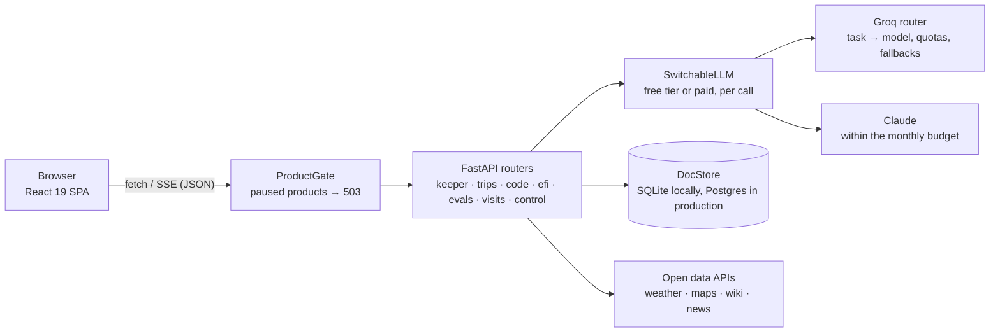

# How it works

This is the explainer for the whole application: what happens on a request, how the backend and frontend are put
together, and the methods behind the parts people ask about (the card shuffle, the product strip, Tara's routing, the
evals). It is written for engineers and for walking someone through the code. File paths are relative to the repository
root.

- [1. The big picture](#1-the-big-picture)
- [2. Frontend](#2-frontend)
  - [2.1 App shell: routing, code splitting, skins and themes](#21-app-shell-routing-code-splitting-skins-and-themes)
  - [2.2 The product catalogue](#22-the-product-catalogue)
  - [2.3 The personal space: motion methods](#23-the-personal-space-motion-methods)
  - [2.4 Tara in the browser](#24-tara-in-the-browser)
  - [2.5 Quality, Insights and the control room](#25-quality-insights-and-the-control-room)
- [3. Backend](#3-backend)
  - [3.1 The application and its middleware](#31-the-application-and-its-middleware)
  - [3.2 The model layer: router, switch and budget](#32-the-model-layer-router-switch-and-budget)
  - [3.3 Tara's pipeline: understand, act, respond](#33-taras-pipeline-understand-act-respond)
  - [3.4 Retrieval (RAG) and confidentiality](#34-retrieval-rag-and-confidentiality)
  - [3.5 Evaluations, history and security controls](#35-evaluations-history-and-security-controls)
  - [3.6 Visits, reminders and code proposals](#36-visits-reminders-and-code-proposals)
  - [3.7 Identity, sign-in and per-person data](#37-identity-sign-in-and-per-person-data)
- [4. Running and testing it](#4-running-and-testing-it)

---

## 1. The big picture



Two Vercel projects serve it: the frontend is a static build (`frontend/`), the backend is FastAPI running as a Python
serverless function (`index.py` wraps `backend/app/main.py`). Locally the same code runs as `uvicorn` + `vite`.

Three rules shape everything:

1. **Nothing made up.** Numbers on the site come from stored runs or the product registry; Tara hands trips to
   Safarnaama (real places and weather) instead of inventing an itinerary; client names are never shown.
2. **Free by default, safe when paid.** Every model call goes through one switch: Groq's free tier unless the owner
   turns on a paid provider, and then only within a monthly budget.
3. **Works on modest devices.** Animations move only `transform` and `opacity`, pause off-screen, and switch off for
   reduced motion or "lite" devices.

---

## 2. Frontend

React 19, Vite, Tailwind CSS v4 and Motion (`motion/react`). Shared primitives live in `packages/web-core`
(`@appcore/web`: router, HTTP/SSE helpers, light/dark mode).

### 2.1 App shell: routing, code splitting, skins and themes

- **Router** (`packages/web-core/src/router.jsx`, used in `frontend/src/Root.jsx`). A small History-API router: `usePath()`
  re-renders on `popstate`; `Link` pushes state. `Root.jsx` maps paths to pages; old names redirect (`/tara` → `/keeper`,
  `/tripweaver` → `/safarnaama`, `/preview/playful` → the personal space).
- **Code splitting.** Every product app and every page except the home page is `React.lazy`: a visitor to the home page
  never downloads CodeLens or the Quality page. The personal space is its own chunk too (Studio visitors never fetch it,
  or its font). Skeletons (`components/Skeleton.jsx`) fill the gap while a chunk loads.
- **Two skins of the home page** (`theme/skin.js`, `theme/theme.js`). `data-skin` on `<html>` is `showcase` (the
  **Studio**, calm and recruiter-first, the default) or `personal` (**Off the clock**, the playful personal space). The
  switch (`theme/SkinSwitch.jsx`) persists the choice and animates with the View Transitions API where available.
- **Light / dark.** `data-theme` on `<html>`: light, dark, or automatic by local time. Components read colours from CSS
  variables, so a theme change is a repaint, not a re-render.
- **Lite mode** (`lib/lite.js`). Turned on for reduced-motion users, low-memory or low-core devices, data-saver, or when
  the first seconds run under 40 fps. It sets `data-lite` (CSS turns off blur and ambient animation) and makes
  `MotionConfig` reduce motion. `?lite=1` / `?lite=0` force it for testing.
- **Search** (`site/CommandPalette.jsx`): Ctrl/⌘ K anywhere, to jump to a product or page, switch skin, or change
  light/dark mode.
- **Visit analytics** (`lib/visits.js`): one cookie-free beacon per page view (see 3.6); never from localhost, Do Not
  Track, or the owner's own browser.

### 2.2 The product catalogue

**One registry, everything derived.** `frontend/src/site/products.js` holds every product once: id, name, the problem
it solves, the outcome, status, visibility, app route, screenshot key and stack.

- `PORTFOLIO` = the featured products (`visibility: 'portfolio'`), sorted by `priority`. Its length is the product
  count shown anywhere on the site; nothing is typed in by hand.
- `FROZEN` = products shown as "in development" (not clickable, code kept and reused).
- **Statuses** follow one rule: *Live* only when the main workflow works end to end, persists, is access-controlled and
  tested; otherwise *Beta* or *In development*. `products.test.js` checks the rules (and that no client is named).
- **Problem-first framing.** Cards lead with the problem ("Planning a trip means juggling a dozen tabs?") and the
  outcome, then *Try it* (the app route) and *Details* (the product page at `/products/<slug>`).
- **Screenshots** are pre-rendered `public/projects/<key>.webp` files, lazy-loaded; a product without one falls back
  to a coloured tile.

The same registry feeds the Studio (`site/ShowcaseHub.jsx`: a sticky product story and a sideways "in development"
shelf), the personal space (2.3), product pages, search, and Tara's product hand-off list on the backend (3.3).

### 2.3 The personal space: motion methods

`frontend/src/site/personal/PersonalSpace.jsx`. Bright, condensed type (Oswald), playful motion. Four principles apply to
every effect:

1. **Compositor-only properties.** Only `transform` and `opacity` animate, so the browser can move layers on the GPU
   without layout or repaint. Moving cards carry `will-change: transform`.
2. **Motion values, not React state, for anything tied to the pointer or the scroll.** `useScroll`, `useMotionValue`
   and `useTransform` update styles directly; React does not re-render while you scroll or swipe.
3. **Pause what you can't see.** `useInView` gates every loop (the deck shuffle, the panning screens).
4. **Respect the device.** With reduced motion or lite mode, `still` is true: loops stop, scroll-linked effects rest at
   their final state, and `MotionConfig` makes the rest instant.

#### The card shuffle (the hero deck)

A small **state machine in `useReducer`**:

```
state = { order: [card ids, back → front], tossing: id | null, dir: ±1 }

toss    → if nothing is flying, mark the front card (order.at(-1)) as tossing; alternate the direction
landed  → move the tossed card to the start of `order` (the back of the stack); tossing = null
shuffle → rotate `order` by two (a click)
```

- **Fan geometry.** Each card's slot is its position in `order`, centred: `c = pos − (n−1)/2`. Its target is
  `x = c × 66px`, `rotate = c × 6.5°`, `y = |c| × 10px` (outer cards sit a little lower). Hovering the deck sets
  `spread`, widening it to `128px` and `11°`. Everything scales with the screen (`s = min(1, width / 760)`).
- **The toss.** While a card is `tossing`, its target becomes "fall down and away": `x = dir × 160`, `y = 420`,
  `rotate = dir × 32°`, `scale = 0.9`, with an **ease-in** curve (`[0.55, 0, 0.8, 0.4]`, accelerating like a drop) over
  0.55 s. When that animation completes, `landed` moves it to the back. Its `z-index` becomes the lowest, and the normal
  **spring** (`stiffness 260, damping 22`) carries it back up *behind* the others. That spring is the "tucks into the
  back" motion.
- **Auto play.** A `setInterval` dispatches `toss` every 2.6 s, but only while the deck is on screen, the tab is
  visible, and nobody is hovering or dragging it.
- **Fling it yourself.** Only the front card is draggable (`drag`, `dragSnapToOrigin`, elastic 0.6). On release, if it
  moved more than 90 px or faster than 600 px/s, it is tossed in the direction you threw it; otherwise it springs home.
- **The lean.** A window `pointermove` listener maps the cursor to −1…1 in two motion values. `useTransform` maps those
  to `rotateY ±10°` / `rotateX ±8°`, smoothed by springs, on a container with `perspective: 1000px`.

#### The product strip (Featured work)

A **native horizontal scroll container with CSS scroll-snap**, so swiping is the browser's own (smooth on any device),
with the look computed from the scroll position:

- **Layout.** `display: flex; overflow-x: auto; scroll-snap-type: x mandatory`; each card `scroll-snap-align: center`
  and `scroll-snap-stop: always` (one product per swipe). Side padding of `(viewport − cardWidth) / 2` lets the first
  and last cards reach the centre. Card width `W = min(420px, 72vw)`, gap `0.14 W`, step `= W + gap`.
- **The tilt.** `useScroll({ container })` gives `scrollX`. Each card computes its distance from the centre in cards:
  `d = i − scrollX / step` (0 = centred). From `d`: `rotate = clamp(d, ±1.4) × 10°`, `y = min(|d|, 1) × 30px`,
  `scale = 1 − min(|d|, 1) × 0.12`. Centred cards stand upright; neighbours tilt away and sink.
- **Which one is centred** (for the live screen and labels): `round(scrollX / step)`, updated by `useMotionValueEvent`.
  React only re-renders when that whole number changes.
- **Mouse drag.** Touch and trackpads scroll natively. For a mouse, a press only becomes a drag once the pointer has
  moved more than 6 px. Only then does the strip capture the pointer and turn snapping off, and `pointermove` sets
  `scrollLeft` directly. On release it scrolls smoothly to the nearest step and snapping is restored. A plain click is
  never captured, so *Try it* and *Details* open normally; only the click that ends a real drag is swallowed. (Capturing
  on press, as an earlier version did, sent every click to the strip instead of the link, so no product opened.)
- **The live screen.** The centred card's screenshot is 125% tall and pans `0 → −16%` and back over 9 s, like a screen
  recording. Only the centred card pans, and only while on screen.

#### The other effects

| Effect | Method |
| --- | --- |
| Name and headings rise word by word | Each word sits in an `overflow: hidden` span; the inner span animates `y: 105% → 0` with a stagger of 0.08 s per word. Letters of the name spring up on hover (`stiffness 500, damping 12`). |
| Role line fills in as you scroll | Two layers per word (grey below, dark above). The dark layer's `opacity` maps to that word's slice of the line's scroll progress (`useScroll` with offsets `start 0.85 → end 0.4`). |
| Skill cards drop in | An under-damped spring (`stiffness 140, damping 11`) from `y: −280` gives the bounce; cards are staggered by 0.12 s, then their tool chips pop in one by one. |
| Tech names stream past | A CSS `@keyframes` loop of `translate3d(−50%)` over a duplicated row, so it runs on the compositor with no JavaScript per frame. The fading edges are two fixed gradient overlays, not a CSS mask: a mask over moving content forces a repaint every frame, and was the main source of lag. |
| In-development cards | Flip in with `rotateY: −80° → 0` (perspective on the grid); on hover the back card fans out and the screenshot pans. |
| CONTACT stretches up | `scaleY` maps the footer's scroll progress (`start end → end end`) from 0.08 to 1, anchored at the bottom; each letter squashes and stretches on hover. |
| Palette button | Swaps the four card colours. Text on a card uses `inkOn(colour)`, the WCAG relative-luminance formula, to pick white or near-black. |
| Dark mode | All colours are CSS variables on `.pl-root`, redefined under `html[data-theme="dark"]`. |
| Links from other pages | `/#experience` from the Quality page: this space loads lazily, so after mount it scrolls to `location.hash` once the section exists. |

It also carries everything the rest of the site offers:
- **Navigation:** section links, search, theme and the switch to Studio.
- **Your details:** local time, social links, availability, at-a-glance numbers, industries (never client names) and "Right now" notes.
- **Products:** *Try it* / *Details* on each card, with Live/Beta labels.
- **Experience:** each role expands to its details.
- **Contact and help:** the contact form, the "Ask Tara about my work" chat, scroll progress, back-to-top and a skip link.

### 2.4 Tara in the browser

`frontend/src/products/keeper/`.

- **Voice** (`voice.js`): one continuous speech-recognition session handles both "Hey Tara" and the request, so nothing
  is lost between the wake word and the question. End-of-speech detection waits ~1.8 s of quiet, or ~3.5 s if the sentence
  ends on a dangling word ("and…", "to…"). Speech out uses the browser's voices; the user's choice of voice, speed and
  pitch is stored on the device (`prefs.js`).
- **Personal settings by voice.** "Use a female voice" or "speak slower" returns a `settings` action that `applySetting`
  applies on the device. No owner key is involved.
- **Cards** (`Cards.jsx`): every action is a card with a button (open, call, message, timer, edit proposal). Product
  hand-offs show *Plan it* / *Open* and open inside the site.
- **Installable**: `keeper.webmanifest` + `sw.js` make it a PWA. `android/` wraps it as a Trusted Web Activity (the
  APK is built by `.github/workflows/tara-android.yml`).

### 2.5 Quality, Insights and the control room

- **Quality** (`site/QualityPage.jsx`, `/quality`).
  - **Runs:** the "Run app checks" button runs every deterministic suite in one request. "Run with live model" runs each model suite in its own request: if the free tier cut a pass short, the next pass asks only the refused cases, up to three passes.
  - **Cards:** each suite shows its score with a 95% interval, macro-F1 or ranking metrics, a trend line, the change since the last run, and a regression flag.
  - **History:** a chart (with the interval as a band) and a table of every run.
  - **Security:** a panel lists each control and the standard it answers to.
- **Insights** (`site/InsightsPage.jsx`, `/insights`, owner key): visits, sources, products, devices, advice computed
  from those numbers, and tagged share links.
- **Control room** (`site/ControlPage.jsx`, `/control`, owner key): the AI provider and budget, product switches, Tara's
  switches, and the change history (see 3.2).

---

## 3. Backend

FastAPI with Pydantic v2 (`backend/app`), the shared core in `packages/py-core` (`appcore`), Safarnaama's API in
`products/safarnama/api`.

### 3.1 The application and its middleware

`create_app()` in `backend/app/main.py` builds the app.
- **Startup (lifespan).** It loads the retrieval service, ingests `documents/`, creates the control room, wraps the model factory in the switch, and starts Tara, Safarnaama and Jasoos.
- **Middleware**, from the outside in:
  1. Security headers (nosniff, referrer policy, CSP, no-store for API responses).
  2. CORS: only the site's own origins; credentials are never allowed.
  3. GZip, except live event streams.
  4. Errors returned as JSON.
  5. **ProductGate**: a product paused in the control room answers 503.
- **Rate limits** (`slowapi`) sit on every endpoint that costs money or can be abused.
- **Storage.** `appcore.docstore.DocStore` is one JSON document table that runs on SQLite locally and Postgres (Neon) in production, chosen by `DATABASE_URL`.

### 3.2 The model layer: router, switch and budget

- **The Groq router** (`packages/py-core/src/appcore/llm/router.py`). Code asks for a *task* (`keeper.command`,
  `codelens.ask`…), never a model.
  - **Classifying:** each task has a complexity class.
  - **Choosing a model:** it picks the smallest free model that can do the job well. It never goes below a task's minimum tier, and an "overkill" penalty keeps big models free for big jobs.
  - **Quotas:** it tracks each model's per-minute and per-day limits from response headers.
  - **When refused:** it waits for a short `retry-after` or falls back to another model.
- **The switch** (`backend/app/control.py`, `SwitchableLLM`). Wraps the router. On every call it reads the control room:
  - **Default:** Groq's free tier.
  - **Paid:** Claude (Haiku / Sonnet / Opus 5.5, with the chosen effort), but only when all four hold:
    - the owner chose it;
    - the product is in the "paid for" list;
    - this month's spend is under the budget;
    - the key is set on the server.
  - **Metering:** token counts from each response are priced and added to the monthly total.
  - **Falling back:** over budget, or if Claude fails, the call quietly falls back to Groq.
  - **Evals stay free:** they set a `FREE_ONLY` context variable, so a public "Run with live model" never spends money.
- **The control room's settings** are a strict Pydantic schema.
  - **Fixed choices:** providers, models and effort levels come from a list; numbers are bounded; unknown fields are refused.
  - **Kept off it on purpose:** secrets and security settings (CORS, the owner key, rate limits).
  - **Change history:** each save stores a from → to diff.
  - **Caching:** settings are cached for 10 s per process, so changes apply within seconds across serverless instances.

### 3.3 Tara's pipeline: understand, act, respond

`backend/app/keeper/agent.py` is a LangGraph graph of three nodes.

**1. Understand.** In order:
- **Offline rules** (`parser.py`, `tools.py`) parse the message, so Tara still works when the model is down. A tool
  request ("weather in Pune") beats the "X is in Y" storage pattern.
- **Products first** (`rule_product`). Requests one of the site's products is built for go to it:
  - trips, itineraries, places to visit, getaways → Safarnaama, with the place read from the words, or the home city
    for "nearby";
  - a GitHub repo → CodeLens;
  - a failing build or stack trace → Jasoos.
  - Naming a product about an earlier request ("why didn't you use Safarnaama?") hands that request over. A short "yes /
    do it / I want one" after Tara mentioned a product accepts the offer without calling the model.
- **The model router.** It gets a system prompt with the tools, the product inventory, the 20 expert personas and the
  conventions, plus the last few turns. It returns one JSON command (action, tool and args, mood, persona), validated
  by Pydantic.
- **Guards after the model.**
  - "Change your voice" is a personal setting, never a code change.
  - If the model chose chat, web search or directions for a product's job, the product wins.
  - The travel-planner persona answering in chat means Safarnaama.
  - The place read from the user's words beats the model's guess; "nearby" is never a destination.

**2. Act.** It saves or finds the user's things (reminders, bills, where things are), calls a look-up tool (weather, news,
wiki, rates, the site's own code or documents), or builds a device action (open, call, message, timer, a product
hand-off with its link already filled in, e.g. `/safarnaama?to=Bengaluru`).

**3. Respond.** The chosen persona's brief and the user's tone and length set the answer.
- **Sources:** look-up results are the only facts allowed.
- **Never invented:** it never makes up the user's data, itineraries, prices or opening hours.
- **Feelings:** they shape the wording, and a crisis message always gets a safety response first.

### 3.4 Retrieval (RAG) and confidentiality

- **Ingestion** (`backend/app/rag/ingestion.py`). It loads `documents/`, chunks the text, embeds it with FastEmbed and
  upserts the chunks.
  - **Incremental:** only files whose hash changed are re-indexed.
  - **Client names removed first:** before chunking, they are replaced with neutral descriptions
    (`rag/redact.py`).
  - **Re-indexing after a rule change:** the stored hash includes the redaction rules' version, so changing the rules
    re-indexes everything once.
- **Retrieval** (`rag/retriever.py`). BM25 and dense vectors, fused with reciprocal rank fusion.
- **Pipeline:** a LangGraph pipeline adds a prompt-injection guard, query rewriting with chat memory, and answers
  with citations.

### 3.5 Evaluations, history and security controls

`backend/app/evals.py`; the Quality page is its UI.

- **App checks** run the real code paths on labelled sets: Tara's offline rules and device actions, CodeLens retrieval,
  Safarnaama place detection, Jasoos log parsing, JSON recovery and the security controls.
- **Model evals** call the live model on labelled sets (routing, emotion, persona).
  - **What's scored:** only cases the model actually answered; a refused call is "not measured", never "wrong".
  - **Pacing:** calls run one at a time and honour the provider's retry hints.
  - **Resuming:** a partial run can be continued for just the refused cases.
- **Statistics enterprises use.**
  - **Accuracy:** with a 95% **Wilson interval**, so a small set says how sure it can be.
  - **Labelling tasks:** **macro-F1** with per-label precision and recall.
  - **Retrieval:** **hit@1 / hit@3**, **MRR@10** and **nDCG@3**.
  - **Latency:** p50 / p95.
  - **Reliability:** coverage and fallback rate.
  - **Standards:** each suite names the categories it measures (ISO/IEC 25010, NIST AI RMF; aligned with, not
    certified).
- **History.** Every run is stored under its own id. `/api/evals/latest` adds each suite's last 12 values, the change
  since the previous run, and a **regression** flag for a drop of 5 points or more; `/api/evals/history` returns every
  run.
- **Security suite** (13 controls, each exercised against the running app and mapped to OWASP Top 10 for LLM apps,
  OWASP API Top 10, ISO 25010 and NIST AI RMF):
  - owner-only APIs refuse anyone without the key;
  - no secret appears in any public response;
  - other websites can't call the API from a browser (CORS);
  - security headers are on every response;
  - oversized input is refused;
  - rate limits sit on costly routes;
  - code proposals can't touch protected paths;
  - a tampered proposal is refused;
  - prompt injection is blocked;
  - client names are never shown;
  - paid spend is capped;
  - trips aren't made up;
  - visit analytics stay private.

### 3.6 Visits, reminders and code proposals

- **Visits** (`backend/app/visits.py`).
  - **No cookies, no IPs stored:** a visitor is a salted hash of (day, network, browser) that changes daily.
  - **What's kept:** only the path, the referring site, the screen-width class and the tag on the link that brought the visitor (`?ref=linkedin`).
  - **Bots** are dropped.
  - **The owner's summary** compares this period with the last, and gives advice that quotes the numbers it rests on.
- **Reminders.** An external scheduler calls `/api/cron/tick` with a shared secret. Due reminders go out by ntfy or
  Telegram, and a heartbeat shows when it last ran.
- **Code proposals** (owner only). Tara plans an edit; the plan is **HMAC-signed** and expires after 30 minutes. When the owner
  approves, the backend re-checks it:
  - **Signature:** it must match.
  - **Protected paths:** never secrets, CI or deployment files, and never outside the repository.
  - **One at a time:** one open proposal at once.

  It then starts a GitHub workflow that opens a pull request, and a review job checks it. Branch protection means only a
  human merge reaches `main`.

### 3.7 Identity, sign-in and per-person data

Every product keeps each person's data apart. `backend/app/identity.py` decides who is calling, in this order:

1. **The site owner:** a valid owner key (`X-Tara-Owner-Key`), sent from the owner's own browser once it has been
   unlocked in Insights, the control room or Tara.
2. **A signed-in account:** Google or an emailed link through Neon Auth. The browser sends the short-lived JWT as
   `Authorization: Bearer …`; the server verifies it against Neon's public keys (`appcore.accounts`).
3. **A browser:** a random id the browser makes once (`X-Visitor`, from `packages/web-core/src/identity.js`).

Only hashes are used as ids; tokens, JWTs and user ids are never stored, and nothing in a request body can choose who
you are.

- **Tara:** every row has an `owner` column (added without touching existing rows, which become the owner's). Each
  request sets whose data it is in a context variable (`app.keeper.store.OWNER`), and every read and write filters on
  it. Even with another person's entry id you get 404. Work outside a request (the reminder tick, the morning brief)
  sees only the owner's data, so phone pushes are the owner's alone; other people's reminders ring inside Tara.
- **CodeLens:** each repository records who indexed it. "All repos" lists only yours and only you can delete yours;
  a repo's link still opens for anyone (share it with a new joiner). Indexed code is public GitHub code.
- **Jasoos:** signed in, investigations belong to the account; otherwise to this browser's owner token.
- **Safarnaama:** trips work the same way (it was the first to have sign-in).
- **FlowForge:** a flow's Tara step saves into the Tara of whoever runs the flow; webhooks have no caller and use the
  owner's.
- **One sign-in for everything.** The Neon Auth client lives in `packages/web-core/src/account.js`, shared by every
  product, so signing in anywhere signs you in everywhere. The **Sign in** button sits in every product header and in
  Tara's sidebar (`frontend/src/site/AccountButton.jsx`). It's optional: everything works without it, for that browser.
- **Claiming.** On signing in, `claimAll()` asks Tara, CodeLens and Safarnaama to move what this browser made into the
  account (`POST /api/keeper/claim`, `/api/code/claim`, `/api/trips/claim`), so it follows you to every device.
- **In-development apps** (CareerPilot, FlowForge, Evolve, MeetingMind) still keep one shared store, so they are paused
  by default (the control room can open them for a demo) and their pages say so.

---

## 4. Running and testing it

```bash
# backend (from backend/)
python -m uvicorn app.main:app --port 8000
# frontend (from frontend/)
npm run dev:local     # talks to the backend above
npm run dev           # talks to the DEPLOYED backend (local backend changes are not used)
```

In development a small badge in the corner says which backend the page is using. It is amber for the deployed one and
green for local.

- **Backend:** `pytest` (the model is always scripted in tests; no live calls) and `ruff check` / `ruff format`.
- **Frontend:** `npm run lint`, `npm test` (Vitest), `npm run build`.
- **Live-model checks** are manual ("Run with live model" on the Quality page) and always run on the free tier.
